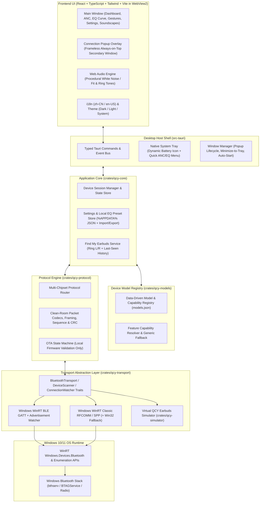

# QCY Audio for Windows — Environment Audit & Architecture Plan

> **Document Status:** Finalized Production Architecture (`v1.0` — **Gate-0 PASSED, APK Specs & IPC Contract Locked**)
> **Owner:** `@env-architect`
> **Upstream Specifications (Complete):**
> - `docs/protocol-spec.md` (`@apk-protocol`) — *Complete (`com.qcy.audio.google` v1.2.3: 100% BLE GATT daily control, 88 active CMDIDs, 4 EQ dialects, 24B BLE Adv popup, 9 OTA routes)*
> - `docs/feature-matrix.md` (`@apk-features`) — *Complete (58 Activities, 46 hardware keys, 43 models in `crates/qcy-models/data/models_catalog.json`, 22 EQ presets in `eq_presets.json`, 669-key bilingual i18n)*
>
> **Status Update:** All reverse-engineering specs, Gate-0 Windows GNU build verification, `crates/qcy-transport` WinRT BLE/RFCOMM backends, `src/audio/**` procedural Web Audio & RBJ biquad DSP engine, `src/assets/DeviceIllustrations.tsx`, `src/i18n/**`, and the canonical Tauri v2 IPC contract (`src/types/qcy.ts`, `src/ipc/client.ts`, `src/store/useQcyStore.ts`) are finalized.

---

## 1. Local Windows Environment & Readiness Audit

All checks below were executed read-only on the reference Windows 10 x64 development host.

### 1.1 Operating System, WebView2 & Bluetooth Stack

| Component | Observed Status | Details |
| :--- | :--- | :--- |
| **OS** | **Windows 10 Enterprise LTSC (x64)** | Version `10.0.19044`, Build `19044` (21H2 LTSC) |
| **WebView2 Runtime** | **Installed** | `Microsoft Edge WebView2 Runtime` `v154.0.4258.62` (HKLM WOW6432Node) |
| **WinRT Metadata & BT DLLs** | **Available** | `C:\Windows\System32\WinMetadata\Windows.Devices.winmd` (868,296 bytes), `Windows.Devices.Bluetooth.dll`, `BluetoothAPIs.dll`, `bthprops.cpl`, `ws2_32.dll`, `combase.dll` |
| **WinRT Bluetooth Runtime Check** | **Verified Working** | Successfully loaded `BluetoothAdapter`, `GattDeviceService`, `RfcommDeviceService`, and `BluetoothLEAdvertisementWatcher` |
| **Windows Bluetooth Services** | **Running** | `bthserv` (`Running`, Manual), `BTAGService` (`Running`, Manual) |
| **Bluetooth Radio Hardware** | **Active Dual-Mode (Classic + BLE)** | `Generic Bluetooth Radio` (`USB\VID_0A12&PID_0001`, CSR8510 A10), Microsoft Bluetooth LE Enumerator (`BTH\MS_BTHLE`), Microsoft Bluetooth Enumerator (`BTH\MS_BTHBRB`), `Bluetooth Device (RFCOMM Protocol TDI)` (`BTH\MS_RFCOMM`) |

### 1.2 Installed Toolchains & SDKs

| Toolchain / Tool | Status | Observed Version / Location |
| :--- | :--- | :--- |
| **Rust / Cargo / Rustup** | **Installed** | `rustc 1.100.0` (2026-11-09), `cargo 1.100.0`, default toolchain: **`stable-x86_64-pc-windows-gnu`**; includes `clippy`, `rustfmt`, `rust-analyzer` |
| **C / C++ (MinGW-w64 UCRT)** | **Installed** | `gcc` / `g++ 16.2.0` (`MinGW-W64 x86_64-ucrt-posix-seh`, WinLibs), `dlltool`, `windres`, `ar`, `ld` on `PATH` |
| **CMake / Ninja** | **Installed** | `cmake 4.4.4`, `ninja 1.13.2` |
| **Node.js / npm** | **Installed** | `node v24.21.0`, `npm 11.19.0` (registry: `https://registry.npmjs.org/`) |
| **Python & Packaging** | **Installed** | `Python 3.12.10`, `pip 25.0.1`, `uv`, `pyinstaller 6.22.3`, `pywin32 312`, `pillow 12.3.0`, `tkinter 8.6` *(GUI/BLE packages `PySide6`, `bleak`, `winrt-*`, `pystray`, `pytest` are NOT currently installed)* |
| **.NET SDK** | **NOT Installed** | `dotnet` not on PATH or in `Program Files\dotnet` |
| **Visual Studio / MSVC / MSBuild** | **NOT Installed** | `vswhere`, `cl`, `msbuild`, and `Windows Kits\10\Include` absent |
| **Other Package Managers** | **NOT Installed** | `winget`, `choco`, `scoop`, `pnpm`, `yarn`, `bun`, `pkg-config` absent |
| **Other Runtimes / Toolchains** | **NOT Installed** | `Java`/`JDK` (relevant for JADX), `Go`, `Flutter`, `Qt` (`qmake`), `clang` absent |

### 1.3 Workspace, Git & GitHub CLI Readiness

| Check | Status | Details |
| :--- | :--- | :--- |
| **Workspace Repository** | **Initialized (`main`)** | Clean-room Git repository with strict `.gitignore` excluding `*.apk`, `*.xapk`, build outputs, and secrets |
| **Git** | **Ready** | `git 2.56.0.windows.3` with local author identity and credential helper configured |
| **GitHub CLI (`gh`)** | **Authenticated** | `gh 2.103.2` authenticated against `github.com` (SSH transport ready) |
| **SSH Transport** | **Ready** | Standard GitHub SSH keypair and host configuration verified |

---

## 2. Technology Stack Evaluation & Recommendation

### 2.1 Candidate Comparison (Grounded in This Machine's Installed Toolchains)

| Criterion | **1. Tauri v2 (Rust + React/TS) + `windows` crate** *(Recommended)* | 2. Pure Rust GUI (`slint` / `egui`) + `windows` crate *(Fallback #1)* | 3. C# / .NET 8+ (WPF / Avalonia) + WinRT | 4. Python 3.12 + PySide6 + `bleak` + `winrt` *(Fallback #2)* | 5. Electron + Node.js Native BT Addons |
| :--- | :--- | :--- | :--- | :--- | :--- |
| **Works with currently installed toolchains?** | **Yes** (`rustc 1.100.0` GNU + MinGW + `node 24` + WebView2 `v154` all present) | **Yes** (`rustc 1.100.0` GNU + MinGW present) | **No** (`.NET SDK` & `winget` missing; requires manual ~250 MB install) | **Partial** (`Python 3.12` + `uv` present, but requires installing `PySide6`, `bleak`, `winrt-*`, `qasync`) | **No** (native Bluetooth N-API addons require MSVC / `node-gyp`) |
| **Windows BLE GATT + Advertisements** | **First-class** via official Microsoft `windows` crate (`Windows.Devices.Bluetooth.*`) | **First-class** (same `windows` crate) | **First-class** (`CsWinRT` via `net8.0-windows10.0.19041.0`) | **Good** (`bleak` uses `winrt`) | **Poor** (fragile native C++ addons) |
| **Windows Classic BT RFCOMM / SPP** | **First-class** via `windows` crate (`RfcommDeviceService` + `StreamSocket`, plus Win32 `AF_BTH` fallback) | **First-class** (same `windows` crate) | **First-class** (`Windows.Devices.Bluetooth.Rfcomm`) | **Moderate** (`socket.AF_BLUETOOTH` or `winrt-*`, tricky with Qt event loop) | **Very Poor** (no mature maintained Windows RFCOMM addon) |
| **Modern Fluent UI, EQ Curve, CJK Typography** | **Excellent** (React + TypeScript + Tailwind + SVG/Canvas Bezier EQ + native WebView2 font shaping) | **Moderate** (CJK font embedding & smooth consumer-audio visuals require more custom work) | **Very Good** (WPF / Avalonia Fluent themes) | **Good** (Qt QSS/QML styling) | **Excellent** (Chromium) |
| **Popup Overlay & Live System Tray** | **Built-in** (Tauri v2 multi-window transparent frameless overlay + `tray-icon` dynamic RGBA icon) | **Moderate** (multi-window overlay & tray integration more manual) | **Very Good** (native Win32/WPF windows + `NotifyIcon`) | **Good** (`QSystemTrayIcon` + frameless `QWidget`) | **Good** (multi-window + `Tray`) |
| **Audio Utility (White Noise / Test Tones)** | **Built-in** (Web Audio API procedural synthesizer — zero external audio libs or copyrighted assets) | Requires Rust audio DSP (`cpal`/`rodio`) | Requires `NAudio` / `WASAPI` | Requires `sounddevice` / `QtMultimedia` | Built-in (Web Audio API) |
| **Binary Size & Memory Footprint** | **~8–15 MB** binary, low RAM (shared OS WebView2) | **~5–10 MB** single static `.exe`, lowest RAM | ~20–60 MB self-contained `.exe` | **~90–150 MB** PyInstaller bundle (frequent AV false positives) | **~150–220 MB** bundle, high RAM |
| **Automated Testability** | **Excellent** (`cargo test` for Rust core/protocol/simulator + `vitest`/`tsc` for UI) | **Excellent** (`cargo test`) | **Excellent** (`xUnit` / `NUnit`) | **Good** (`pytest`) | **Good** (`vitest`) |

### 2.2 Primary Recommendation: **Tauri v2 (Rust + React/TypeScript) + Microsoft `windows` Crate**

Why this stack is the clear winner on this machine:
1. **Zero Toolchain Blockers Today:** Rust (`1.100.0`), MinGW-w64 (`gcc 16.2.0`, `windres`, `dlltool`), Node.js (`v24.21.0`), npm (`11.19.0`), and Microsoft Edge WebView2 Runtime (`v154.0.4258.62`) are **all already installed**.
2. **True Dual-Transport Native Windows Bluetooth:** QCY earbuds across chipsets (BES, Bluetrum, Jieli, Wuqi, Qualcomm, Realtek, Airoha, etc.) commonly require **BLE GATT**, **BLE Advertising/Manufacturer Data parsing**, and/or **Classic Bluetooth RFCOMM/SPP**. The official Microsoft `windows` crate exposes every WinRT Bluetooth namespace directly with `async` support and ships prebuilt GNU import libraries (`windows_x86_64_gnu`) so **no MSVC or Windows SDK headers are needed**.
3. **Consumer-Grade Audio App UX:** Tauri v2 natively supports frameless transparent always-on-top secondary windows (for the **QCY Connection Popup Overlay**), dynamic system tray icons (for **live L/R/Case battery status + quick ANC toggle**), crisp Chinese/English (`zh-CN` / `en-US`) typography, SVG/Canvas interactive multi-band EQ curve editing, and built-in **Web Audio API** procedural synthesis for sleep/white-noise soundscapes and fit/hearing tones.
4. **Clean Separation of Concerns:** All protocol parsing, Bluetooth transport, device model capability logic, and the Virtual Earbuds Simulator live in pure Rust workspace crates (`cargo test` runs in seconds, completely decoupled from the UI).

### 2.3 Gate-0 Build & Runtime Verification on `x86_64-pc-windows-gnu` (**PASSED**)

An isolated Gate-0 smoke-test project (`gate0_tauri`, kept outside the repository in scratch) was compiled, linked, inspected, and executed live on this Windows 10 Enterprise LTSC (`10.0.19044`) host using the installed `stable-x86_64-pc-windows-gnu` toolchain (`rustc 1.100.0` + WinLibs MinGW-w64 `16.2.0`):

- **Verified Crate Stack:**
  - `tauri = "2"` (`2.12.7`, features: `["tray-icon", "image-png"]`) + `tauri-build = "2"` (`2.7.6`) + `wry` (`0.57.3`) + `webview2-com` (`0.39.1`) + `tray-icon` (`0.25.1`)
  - `windows = "0.62"` (`0.62.2` — **matches Tauri v2.12's internal `windows` dependency version**, avoiding duplicate `windows` crate compilation!) with features: `Foundation`, `Foundation_Collections`, `Storage_Streams`, `Networking_Sockets`, `Devices_Enumeration`, `Devices_Bluetooth`, `Devices_Bluetooth_GenericAttributeProfile`, `Devices_Bluetooth_Rfcomm`, `Devices_Bluetooth_Advertisement`.
- **Live Execution Output (`gate0_tauri.exe --smoke-test`, exit code `0`):**
  ```text
  GATE0_WINRT_BT_OK: adapter=<REDACTED_BT_MAC> classic=true le=true scan_mode=BluetoothLEScanningMode(0) paired_ble=0 paired_classic=1 gatt_aqs_len=243 rfcomm_aqs_len=385
  GATE0_TAURI_SETUP_OK: has_main=true tray=ok
  GATE0_EXITING_CLEANLY
  ```
  This proved end-to-end on real local hardware:
  1. WinRT `BluetoothAdapter`, `BluetoothLEAdvertisementWatcher`, `BluetoothLEDevice`, `BluetoothDevice`, `GattDeviceService`, `RfcommDeviceService`, `StreamSocket`, and `DeviceInformation::FindAllAsyncAqsFilter` all link and execute natively under `-gnu` without MSVC or Windows Kits headers.
  2. Tauri v2 WebView2 window creation and `TrayIconBuilder` initialize cleanly on Windows 10 LTSC.
- **Verified DLL & `WebView2Loader.dll` Packaging Behavior:**
  - `objdump -p gate0_tauri.exe` confirmed the binary depends **only** on standard Windows OS DLLs (`api-ms-win-core-winrt-l1-1-0.dll`, `combase.dll`, `kernel32.dll`, `WS2_32.dll`, `user32.dll`, UCRT API sets) plus **`WebView2Loader.dll`** — **zero MinGW runtime DLLs** (no `libgcc_s_seh-1.dll` or `libstdc++-6.dll`).
  - **`webview2-com-sys v0.39.1` automatically copies `WebView2Loader.dll` (`160,880` bytes, x64) straight into `target/<profile>/WebView2Loader.dll` during `cargo build`**, so `cargo run` and launching directly from `target/debug/` or `target/release/` works out of the box!
  - **Distribution rule:**
    - Local GNU portable builds: bundle the adjacent `target/release/WebView2Loader.dll` (160 KB) alongside `qcy-desktop.exe` (or via `tauri-bundler >= 2.2.2`).
    - **Public GitHub Releases (CI):** GitHub Actions `windows-latest` compiles with `x86_64-pc-windows-msvc`, statically linking `WebView2LoaderStatic.lib` into a **single self-contained `.exe` + NSIS installer** with zero companion DLLs.
- **Observed Minor GNU Engineering Notes (for Phase 2 Scaffolding):**
  - `tauri-winres` + MinGW emits a non-fatal linker warning (`ld.exe: .rsrc merge failure: multiple non-default manifests`); harmless, does not block linking or runtime.
  - Default unoptimized GNU debuginfo produces large debug binaries (~260 MB); configure `[profile.dev] debug = "line-tables-only"` (or `debug = 1`) and `[profile.release] lto = "thin", codegen-units = 1, strip = true` in the workspace `Cargo.toml` for fast dev links and compact ~8–15 MB release executables.
  - Explicitly remove/drop tray icons on the main thread before `app.exit(0)` to guarantee clean tray teardown without stderr warnings.
- **Fallback Status:** Fallback #1 (`slint`/`egui`) is **NOT needed** — Tauri v2 + `windows 0.62` is 100% verified on this machine!

---

## 3. Layered Clean-Room Architecture

### 3.1 System Architecture Diagram



### 3.2 Planned Repository & Workspace Layout

```text
qcy-audio-windows/                     # Public GitHub repo root
├── .github/
│   └── workflows/
│       ├── ci.yml                     # fmt, clippy, cargo test, vitest, tsc, MSVC Tauri build
│       └── release.yml                # Tagged release: portable ZIP + NSIS installer + SHA256
├── docs/
│   ├── architecture-plan.md           # This document
│   ├── protocol-spec.md               # Clean-room protocol specification (@apk-protocol)
│   └── feature-matrix.md              # Feature & device capability matrix (@apk-features)
├── crates/
│   ├── qcy-transport/                 # Layer 1: Async transport traits + WinRT BLE/RFCOMM backends
│   ├── qcy-simulator/                 # Layer 1b: Full Virtual QCY Earbuds Simulator (interactive & CI)
│   ├── qcy-protocol/                  # Layer 2: Pure-byte protocol codecs, framers, CRC, router
│   ├── qcy-models/                    # Layer 3: Device catalog, capability flags, protocol bindings
│   └── qcy-core/                      # Layer 4: Session state machine, settings, EQ presets, Find service
├── src-tauri/                         # Tauri v2 desktop shell, IPC commands, Tray, Popup window
│   ├── src/
│   │   ├── main.rs
│   │   ├── lib.rs
│   │   ├── commands.rs                # Typed IPC command handlers
│   │   ├── tray.rs                    # Dynamic battery icon generator & quick menu
│   │   └── popup.rs                   # Connection popup overlay coordinator
│   ├── icons/                         # Clean-room original app & tray icons
│   ├── Cargo.toml
│   └── tauri.conf.json
├── src/                               # React + TypeScript + Tailwind frontend
│   ├── components/                    # Battery cards, EQ curve canvas, gesture mapper, popup card
│   ├── pages/                         # Dashboard, Sound/EQ, Controls, Lab/Modes, Soundscapes, Devices, Settings
│   ├── audio/                         # Web Audio procedural soundscape & tone engine
│   ├── i18n/                          # zh-CN.json, en-US.json (strict key-parity tested)
│   ├── store/                         # Zustand/React state synchronized with Tauri events
│   └── assets/                        # Original clean-room SVG earbud/headphone illustrations
├── scripts/
│   └── package-portable.ps1           # Packages exe + WebView2Loader.dll for local GNU portable zip
├── Cargo.toml                         # Rust workspace root (pins windows = "0.62", dev/release profiles)
├── package.json                       # Frontend scripts (dev, build, typecheck, test)
├── .gitignore                         # Strictly excludes *.apk, *.xapk, scratch, decompiled dumps, secrets
├── LICENSE                            # MIT (recommended; confirm with maintainer)
└── README.md                          # Bilingual English / 简体中文 documentation
```

---

## 4. Detailed Layer Specifications

### 4.1 Layer 1: Transport Abstraction Layer (`qcy-transport` & `qcy-simulator`)

All hardware I/O sits behind strict async traits so the protocol engine, application services, UI, and tests never couple directly to Windows APIs:

- **Core Traits:**
  - `DeviceScanner`: Starts/stops discovery across BLE advertisements (`BluetoothLEAdvertisementWatcher`) and paired Classic Bluetooth devices (`DeviceInformation::FindAllAsync` + `DeviceWatcher`), emitting `DiscoveredDevice { id, mac, name, rssi, transport_kind, manufacturer_data, service_uuids, is_paired, is_connected }`.
  - `BluetoothConnection`: Unified bidirectional packet/stream channel supporting:
    - `write_gatt(service_uuid, char_uuid, payload, write_with_response)`
    - `read_gatt(service_uuid, char_uuid)`
    - `subscribe_notifications(service_uuid, char_uuid) -> Receiver<Vec<u8>>`
    - `write_rfcomm(payload)` / `subscribe_rfcomm() -> Receiver<Vec<u8>>`
    - `mtu() -> usize`, `disconnect()`, `connection_state_stream()`.
  - `ConnectionEventWatcher`: Watches OS-level Bluetooth connect/disconnect & BLE lid-open advertisements to trigger the Windows Connection Popup Overlay and automatic reconnection.
- **Real Windows Backends (`#[cfg(target_os = "windows")]`):**
  - **WinRT BLE GATT:** Uses `BluetoothLEDevice::FromBluetoothAddressAsync`, `GetGattServicesForUuidAsync`, `GattCharacteristic::WriteValueWithResultAsync` (`WriteWithResponse` / `WriteWithoutResponse`), and `ValueChanged` event hooks with proper COM/WinRT token cleanup on drop to avoid Windows GATT handle leaks.
  - **WinRT Classic RFCOMM/SPP:** Uses `BluetoothDevice::FromBluetoothAddressAsync` -> `GetRfcommServicesForIdAsync` -> `StreamSocket::ConnectAsync` -> `DataReader`/`DataWriter` on a dedicated Tokio I/O task. Includes optional Win32 Winsock (`AF_BTH`, `BTHPROTO_RFCOMM`) fallback if a device exposes non-standard SDP records.
  - **Windows Pairing & Connection UX:** Clearly detects Windows pairing requirements and surfaces actionable prompts (e.g., opening `ms-settings:bluetooth` if Windows requires OS-level Classic pairing first).
- **Virtual QCY Earbuds Simulator (`qcy-simulator`):**
  - Implements `DeviceScanner` + `BluetoothConnection` + `ConnectionEventWatcher` **at the raw protocol-byte level** (not bypassing `qcy-protocol`!). That means the simulator actually parses incoming encoded protocol packets from `qcy-protocol` and replies with real protocol response/notification bytes!
  - Supports switching between multiple representative virtual QCY models (e.g., Flagship ANC TWS, Over-Ear ANC Headphone, Open-Ear / Gaming TWS — finalized from `docs/feature-matrix.md`).
  - Interactive Simulator Control Drawer (accessible in Demo Mode): simulate **Lid Open / Popup trigger**, **L/R/Case battery levels & charging states**, **In-Ear wear/remove**, **Hardware earbud button tap**, **Disconnect / Reconnect**, and **Protocol latency / packet drop**!

### 4.2 Layer 2: Protocol Engine Layer (`qcy-protocol`) — Finalized from `docs/protocol-spec.md`

- **Zero-I/O Pure Rust Crate:** Compiles and tests identically on Windows and Linux with zero OS/GUI dependencies.
- **Confirmed Transport Split (Critical Discovery):**
  - **Daily Device Control = 100% Unauthenticated BLE GATT** (no Classic SPP/HFP required for everyday ANC, EQ, gestures, modes, battery, RGB, or focus mode!):
    - **Passive Discovery & Popup (No GATT Connect Needed):** Active BLE scan filtering Company IDs `0x071E`, `0x521C`, `0x522C` decodes the 24-byte Manufacturer Data payload (`modelID` `[0..1]` BE, `isLeft`/`colorIndex` `[3]`, `isTws`/`isPop` `[4]`, L/R/Case battery + charging `[5..7]`, swapped Classic MACs `[11..16]` & `[18..23]` via `b1:b0:b2:b5:b4:b3`, `popNum` `[17]`). Classic A2DP OUI prefixes: `84:AC:60`, `1C:52:16`, `C4:33:96`.
    - **Protocol Family 1 — QCY Unified TLV (`0xA001`, Write `0x1001`, Notify `0x1002`, MTU `512`, `100 ms` write pacing):** Used by WuQi (`0x0040`), Bluetrum (`0x0050`), BES (`0x00D0`), Qualcomm (`0x0010`), Realtek (`0x00C0`), Actions, PixArt, ZR (`0x0090`), RD (`0x00A0`). Frame: `[0xFF, PayloadLen, CmdID, VLen, Value...]` supporting multi-TLV notifications and `0xFE 0x01 <CmdID>` reads. Legacy direct characteristics: `0x0007` version, `0x0008` battery, `0x000B` 10-band EQ, `0x000D` button mappings.
    - **Protocol Family 2 — JieLi RCSP (`0xA002`, Write `0x0001`, Notify `0x0002`):** Framed `FE DC BA ... EF`. New JieLi (`modelID & 0x8070 == 0x8070`) tunnels `[0xFF, ...]` QCY TLVs inside RCSP `0xFF` (`CMD_EXTRA_CUSTOM`) with the `OFF=0x02` quirk on `0x06`/`0x09`; Legacy JieLi (`!isNewJL`) uses native RCSP commands (`0x03`/`0x07`/`0x08`/`0xC0`–`0xC5`, translating button action `0 -> 0x7F`).
  - **Complete Command Surface (88 Active CMDIDs):** All 82 `ConstantCMDID` entries + 6 active config-only CMDIDs (`0x33` touch sensitivity, `0x53` power save, `0x57` virtual bass, `0x5C` voice detect, `0x5D` disconnect warning, `0x63` THX EQ), including:
    - All **4 EQ dialects**: `0xFC`/`0x000B` (10-band graphic), `0x20` (6B/band), `0x22` (7B/band with `EQParamBean.irrType` `0..8` + `0xFF=PAD`), and `0x46`/`0x47` (L/R independent personalized hearing EQ).
    - ANC & AI Scene ANC (`0x17`, `0x54`–`0x56`, `0x5A`, `0x65`), 16-level custom ANC, Transparency 1–6 + Vocal Boost, Wind Noise.
    - Touch/Physical Button Remapping (14 assignable actions `cmd 0..18`), IMU Head Controls (`0x50`–`0x52`), Multipoint (`0x24`, `0x4D`, `0x4F`, `0x66`), SP75 RGB LED Lighting (`0x35`/`0x36`) & TWS Pairing, Focus Mode hardware playback (`0x39`–`0x3D`), Clock/Alarms (`0x3E`/`0x3F`).
    - **Find My Earbuds (`0x4B`):** Confirmed UI-only local A2DP stereo chime (`src/audio/audioUtils.ts` `playFindEarbudsChime`, no BLE packet or earbud GPS).
  - **9 Local-File OTA Routes (6 BLE GATT + 3 Classic RFCOMM/SPP):**
    - BLE GATT: `otaType=2` JieLi `0xA002` (unauthenticated), `otaType=6/11` WuQi `0x7033` (`0x2001`/`0x2002`, `11` supports `0xABCD6543` tone `.bin` packs), `otaType=8` BES (`66666666...`/`77777777...`), `otaType=9` JieLi `0xAE00` (*uses `libjl_ota_auth.so` 17B `RcspAuth` — transparently returns `OtaPhase::UnsupportedAuthRequired` in UI rather than failing silently*), `otaType=10` Bluetrum `0xFF12` (`0xFF14`/`0xFF15`).
    - Classic RFCOMM/SPP: `otaType=1` PixArt/AWOTA (SDP `0x1101`, `"PA"`/`"PI"`), `otaType=5` Qualcomm GAIA (`00001107-D102-11E1-9B23-00025B00A5A5`), `otaType=7` Actions (`0000E003-...`).

### 4.3 Layer 3: Device Model & Capability Registry (`qcy-models`) — Finalized from `crates/qcy-models/data/`

- **Embedded Clean-Room Data Catalogs (`include_str!`):**
  - `crates/qcy-models/data/models_catalog.json`: **43 QCY models** (`1` generic fallback `qcy-generic`, `26` bundled profiles covering all 34 `res/raw/function_*.json` schemas, and `16` legacy/cloud audio models), each carrying `model_id`, `numeric_model_id` (+ hex), `name_en`/`name_zh`, `form_factor` (`tws` | `open_ear` | `over_ear` | `speaker` | `neckband`), `chipset_family`, `protocol_family`, `ota_type`, `ble_name_hints`, all **56 hardware capability flags**, `default_eq_preset_ids`, and **113 i18n-keyed `pop_view_rules`** mutual-exclusion & reboot guard rules.
  - `crates/qcy-models/data/eq_presets.json`: **22 clean-room EQ presets** (16 official + 1 personalized + 3 SP75 speaker + 2 desktop curated), 5/10/20-band frequency grids, all **9 IIR biquad filter types (`0..8`)**, **5 reference Target FR Curves** (`20–20000 Hz`), and 8-band hearing-test metadata.
- **Dynamic UI & Conflict Guard Engine:** Every dashboard card and settings panel renders strictly from `active_model.capabilities`, while `pop_view_rules` intercepts mutually exclusive toggles (e.g., LDAC vs Dual-Device / Spatial Audio / Game Mode) and presents `MutualExclusionDialog` before forcing hardware reboots.

### 4.4 Layer 4: Application Services, Audio DSP & Tauri IPC Contract (`qcy-core`, `src-tauri`, `src/`)

1. **Settings & Local Persistence (`%APPDATA%\QcyAudioDesktop\state.json`):**
   - Stores saved devices, last-seen battery/timestamps, custom EQ profiles (with JSON Import/Export), theme (`#FF7A2F` brand orange, `#0066FF`/`#3399FF` accent blue, Light `#F2F1F6`/`#FFFFFF` & Dark `#121212`/`#1E1E1E`), locale (`zh-CN` / `en-US`, **669 verified leaf keys**), auto-start (`HKCU\Software\Microsoft\Windows\CurrentVersion\Run`), minimize-to-tray, popup preferences, and Developer Protocol Log toggle.
2. **Procedural Web Audio DSP & Vector Device Art (`src/audio/**`, `src/assets/DeviceIllustrations.tsx`):**
   - `biquadMath.ts`: Exact RBJ + 1st-order + 4th-order Butterworth frequency response evaluator covering all 9 QCY wire filter types (`0..8` + `0xFF` PAD) + standard `band_pass`/`notch`/`all_pass` across 20 Hz–20 kHz.
   - `hearingTestEngine.ts`: Click-free L/R `StereoPannerNode`-isolated pure-tone audiometry wizard (`BeepTool` equivalent) converting L/R dB HL thresholds into normalized 8-band & 10-band EQ compensation curves + suggested balance.
   - `soundscapeEngine.ts`: 8-channel procedural ambient synthesizer (`white_noise`, `pink_noise`, `brown_noise`, `rain`, `ocean_waves`, `forest_wind`, `fireplace`, `deep_focus_drone`), 4 mood presets, smooth gain ramping, and cosine fade-out sleep timer.
   - `audioUtils.ts`: Ear-Tip Fit Test sweep probe + progressive L/R stereo Find-My-Earbuds chime (`0x4B`).
   - `DeviceIllustrations.tsx`: Original clean-room SVG illustrations for all 5 form factors (`tws`, `open_ear`, `over_ear`, `speaker` with live SP75 RGB LED ring preview, `neckband`) with dynamic colorway shading, L/R dimming, and charging indicators.
3. **Finalized Tauri v2 IPC Contract (`src/types/qcy.ts`, `src/ipc/client.ts`, `src/store/useQcyStore.ts`):**
   - **Backend -> Frontend Events (`IPC_EVENTS`):**
     - `qcy://state-updated` (`AppSnapshot`) — full reactive state sync
     - `qcy://popup-triggered` (`PopupTriggerPayload`) — drives frameless always-on-top `popup` window on BLE Adv `isPop` or simulator trigger
     - `qcy://scan-discovered` (`DiscoveredDevice`) — live BLE/paired scan feed
     - `qcy://protocol-log` (`ProtocolLogEntry`) — hex packet stream for Developer Inspector
   - **Frontend -> Backend Commands (`IPC_COMMANDS`):**
     - *Session & Discovery:* `get_app_snapshot`, `list_models`, `get_adapter_info`, `start_scan`, `stop_scan`, `list_paired_devices`, `connect_device`, `disconnect_device`, `remove_saved_device`, `open_windows_bt_settings`
     - *ANC:* `set_anc_state`, `set_ai_anc`, `set_anc_button_cycle`
     - *EQ & Audio:* `apply_eq_preset`, `set_graphic_eq`, `set_parametric_eq`, `save_custom_eq`, `delete_custom_eq`, `import_eq_json`, `export_eq_json`, `apply_personalized_eq`, `set_audio_enhancers`
     - *Gestures & IMU:* `set_button_action`, `reset_buttons`, `set_touch_config`, `set_head_controls`
     - *Modes, Connectivity, RGB & Maintenance:* `set_modes`, `set_multipoint`, `set_rgb_lighting`, `set_focus_white_noise`, `run_fit_test`, `set_device_color`, `rename_device`, `reset_device`, `start_local_ota`, `cancel_ota`
     - *Simulator & Desktop Shell:* `set_simulator_enabled`, `set_simulator_model`, `update_simulator_state`, `trigger_simulator_popup`, `update_app_settings`, `show_popup`, `hide_popup`, `get_protocol_logs`, `clear_protocol_logs`
   - **Conflict-Aware Command Outcome:** Hardware-mutating commands return `CommandOutcome { applied, snapshot, conflict_prompt? }`. When `pop_view_rules` detects a conflict and `force` is not set, `useQcyStore` opens `<MutualExclusionDialog>` and retries with `force: true` upon user confirmation.
   - **Browser & Vitest Fallback:** `QcyIpcClient` transparently falls back to a full in-memory multi-model simulator when `__TAURI_INTERNALS__` is absent.
4. **System Tray & Connection Popup Overlay:**
   - Dynamic RGBA tray icon showing live battery & charging state with quick context menu (ANC Mode, Game Mode, EQ Presets, Simulator Toggle, Open Window, Quit) and clean main-thread tray removal on exit.
   - Frameless, transparent, always-on-top `popup` window (`index.html?window=popup`) triggered by passive 24B BLE Adv (`isPop` / lid open) or Simulator trigger.

---

## 5. Verification & Testing Strategy

| Test Tier | Tooling | Scope & Exit Criteria |
| :--- | :--- | :--- |
| **1. Protocol Unit & Golden Vector Tests** | `cargo test -p qcy-protocol` | Byte-exact encode/decode for every command & notification in `docs/protocol-spec.md`; CRC/checksum verification; partial/coalesced/corrupted stream framing; sequence rollover & timeout retries. |
| **2. Model Registry Validation Tests** | `cargo test -p qcy-models` | Validates `models.json` schema, unique model IDs, valid protocol family references, consistent EQ band counts & gesture action tables. |
| **3. Virtual Simulator Integration Tests** | `cargo test -p qcy-core -p qcy-simulator` | Full end-to-end async lifecycle against virtual earbuds: scan -> connect -> handshake -> battery update -> ANC switch -> custom EQ write/readback -> gesture remap -> Find ring -> disconnect/reconnect recovery. |
| **4. Frontend & Localization Tests** | `npm run typecheck`, `npm run test` (`vitest`) | TypeScript strict mode (`noEmit`), EQ spline & clamping math, capability-based UI rendering, **100% `zh-CN` / `en-US` translation key parity**. |
| **5. Static Analysis & Build Verification** | `cargo fmt --check`, `cargo clippy -- -D warnings`, `cargo tauri build` | Clean lints, local GNU build verification (including `WebView2Loader.dll` packaging check), and GitHub Actions MSVC production build. |
| **6. Interactive & Hardware Checklist** | Manual verification | Live Virtual Earbuds walkthrough (popup, tray icon update, EQ drag, dark/light & zh/en switch) + optional real QCY earbud smoke test on Windows Bluetooth radio. |

---

## 6. Packaging, CI/CD & GitHub Repository Hygiene

### 6.1 Mandatory `.gitignore` & IP / Security Hygiene

Before `git init` and the first commit, enforce strict hygiene rules:
- **Never commit APK/XAPK or RE artifacts:** `.gitignore` MUST explicitly exclude both **`*.apk`** and **`*.xapk`** (plus related mobile/RE artifacts):
  - `*.apk`, `*.xapk`, `*.apks`, `*.aab`, `*.dex`, `*.odex`, `*.vdex`, `*.so`, `*.jar`, `*.class`, `*.smali`
  - `scratch/`, `decompiled/`, `jadx-out/`, `apktool-out/`
  - `target/`, `node_modules/`, `dist/`, `src-tauri/target/`, `*.log`
  - `.env`, `.env.*`, `*.pem`, `*.key`, `*.jks`, `*.keystore`, `*.p12`
- **Clean-Room Asset & Code Policy:**
  - Zero copyrighted PNG/WebP/MP3/Lottie assets copied from the APK/XAPK — all device silhouettes, app icons, animations, and soundscapes are freshly authored (SVG / CSS / Web Audio).
  - Zero proprietary vendor cloud endpoints with secret tokens, signing certificates, or firmware binaries committed to the repo.
- **Pre-Push Secret & File Audit:** Run `git status` and check tracked files (`git ls-files`) before pushing to ensure zero `.apk`/`.xapk` files, decompiled outputs, or sensitive paths exist in git history.

### 6.2 Licensing & Documentation

- **License:** Recommend **MIT License** (permissive, compatible with Tauri/Rust/React ecosystems and standard for community Windows companion utilities; GPL-3.0 is an alternative if copyleft is preferred — confirm with user/coordinator).
- **Bilingual `README.md` (English + 简体中文):**
  - Clear project overview, screenshots (Main UI + Connection Popup + System Tray), supported models & capability matrix, Virtual Simulator quickstart, build instructions (MSVC & MinGW-GNU), protocol documentation links, and an explicit non-affiliation disclaimer (*"Independent, clean-room open-source community project. Not affiliated with or endorsed by QCY / Dongguan Hele Electronics."*).

### 6.3 GitHub Actions Workflows

1. **`.github/workflows/ci.yml`** (runs on push & pull request on `windows-latest`):
   - Rust (`stable-x86_64-pc-windows-msvc`): `cargo fmt --check`, `cargo clippy --workspace -- -D warnings`, `cargo test --workspace`.
   - Frontend (`node 24`): `npm ci`, `npm run typecheck`, `npm run test`, `npm run build`.
   - Packaging check: `tauri-apps/tauri-action` / `cargo tauri build` producing statically-linked `.exe` + NSIS installer artifact.
2. **`.github/workflows/release.yml`** (runs on `v*` git tags):
   - Builds Windows x64 MSVC release (both **Portable `.zip`** and **NSIS Setup `.exe`**), generates `SHA256SUMS.txt`, and publishes a GitHub Release automatically.

---

## 7. Architecture Finalization Status

1. **[DONE — Gate-0 PASSED]** Tauri v2 (`2.12.7`) + `windows` (`0.62.2`) WinRT Bluetooth (BLE GATT + Classic RFCOMM + Advertisements) + `tray-icon` compiled, linked, and executed cleanly on `stable-x86_64-pc-windows-gnu` with automatic `WebView2Loader.dll` placement in `target/<profile>/`.
2. **[DONE — Transport Verified]** Confirmed 100% BLE GATT daily control (`0xA001` Unified TLV + `0xA002` JieLi RCSP + passive 24B BLE Adv popup) and Classic RFCOMM/SPP OTA routes (`otaType` 1/5/7). Production WinRT backend landed in `crates/qcy-transport`.
3. **[DONE — Chipset / Protocol Families Locked]** `QcyUnifiedTlv`, `JieLiRcspNew` (tunneling TLV in RCSP `0xFF`), `JieLiRcspLegacy`, `LegacyDirectGatt`, 88 active CMDIDs, 4 EQ dialects, and 9 OTA routes (with explicit `UnsupportedAuthRequired` status for `otaType=9`).
4. **[DONE — Feature Parity & IPC Contract Locked]** 43 models (`models_catalog.json`), 22 EQ presets + 9 IIR biquads (`eq_presets.json`), 669-key `zh-CN`/`en-US` i18n, Web Audio DSP (`src/audio/**`), clean-room SVGs (`src/assets/DeviceIllustrations.tsx`), and typed Tauri IPC contract (`src/types/qcy.ts`, `src/ipc/client.ts`, `src/store/useQcyStore.ts`).
5. **[DONE — Verified & Published]** Public repository initialized under MIT `LICENSE` at `https://github.com/hyc1743/qcy-audio-windows` after full build, runtime smoke-test, and `.gitignore` audit.
