# QCY Audio — Android App Feature, UI/UX & Device Catalog Specification

> **Source Artifact (Observed):** `QCY+Audio_1.2.3_APKPure.xapk` (XAPK v2, 38,644,935 bytes) containing `com.qcy.audio.google.apk` (38,488,359 bytes, SHA-256 `840fb10ef0edea868be19adf536ed34170c2ada92f1a2a200d3d64db3ce13b35`), `config.armeabi_v7a.apk`, `config.hdpi.apk`, and `manifest.json`.
> **REA Signature Evidence ID:** `ev_ab2531288d7d4befb580824c32fa40d7cd60236bf791a543a27964b38397cb43`
> **Analysis Scope:** Pure static analysis of `AndroidManifest.xml`, `resources.arsc`, `assets/therouter/routeMap.json`, all 39 `res/raw/*` assets (including `layout_all.json`, `function_all.json`, 34 device `function_*.json` files, `videotutorialapi.json`), and `classes.dex`–`classes4.dex`. No runtime execution or network calls were performed. All vendor API keys, encryption keys, and secrets are redacted (`[REDACTED]`).
> **Target Purpose:** Clean-room, open-source Windows desktop implementation of QCY Audio.

---

## 1. APK Metadata, Architecture & Manifest Overview

### 1.1 Package Identity & Signing Posture

| Field | Observed Value | Source |
|---|---|---|
| **Package Name** | `com.qcy.audio.google` | `AndroidManifest.xml`, `manifest.json` |
| **App Display Name** | `QCY Audio` (`@string/txt_app_name`) | `resources.arsc` |
| **Version** | `1.2.3` (`versionCode = 123`) | `AndroidManifest.xml` |
| **SDK Targets** | `minSdkVersion = 29` (Android 10), `targetSdkVersion = 36`, `compileSdkVersion = 36` | `AndroidManifest.xml` |
| **Application Class** | `com.qcy.audio.QApp` | `AndroidManifest.xml` |
| **Distribution Flavor** | `googlePlay` (dual-flavor codebase supporting `googlePlay` and `domestic` channels in `AppConfigKt`) | `classes*.dex` (`AppConfigKt`) |
| **Signing Schemes** | APK Signature Scheme v2 + v3 + Google Play Source Stamp (no v1 JAR sig); `self_consistent = true` | REA `ev_ab253128...` |
| **Signer Certificate** | Google Play App Signing (`CN=Android, O=Google Inc.`, SHA-256 `158cea99c755183ca4e5be49da12d601d808bd171b49fbbaabab53cfed6419c4`) | REA `ev_ab253128...` |
| **Tech Stack** | Native Android Kotlin/Java (4 DEX files, **unobfuscated** `com.qcy.audio` 2,150 classes + `com.qcymall.qcydevicelibrary` 354 classes), AndroidX DataBinding, Koin DI, Room SQLite DB (`AppData`), Retrofit2 + OkHttp3, TheRouter (`routeMap.json`), Media3 ExoPlayer, XPopup, Google Maps SDK | `classes.dex`–`classes4.dex` |
| **Native Libraries** | `lib/armeabi-v7a/libjl_enc.so`, `lib/armeabi-v7a/libjl_ota_auth.so` (JieLi BLE encryption/OTA auth) | `config.armeabi_v7a.apk` |
| **Embedded Chipset/OTA SDKs** | JieLi (`com.jieli.jl_bt_rcsp`, `jl_bt_ota`, `bluetooth_connect`), Qualcomm GAIA (`com.qualcomm.qti.gaiaclient`), Wuqi (`org.wuqi.android`), Bluetrum (`com.bluetrum.fota`), BES (`BESOtaPresenter`), Actions (`com.actions_local.ibluz`), Airoha/AW (`com.awota.ota` / `T5OTAPresenter`), Realtek (`com.realsil.sdk.dfu.DfuService`) | `classes*.dex`, `AndroidManifest.xml` |

### 1.2 Declared Permissions & Hardware Features

| Permission / Feature | Purpose in App | Windows Desktop Equivalent |
|---|---|---|
| `BLUETOOTH`, `BLUETOOTH_ADMIN`, `BLUETOOTH_CONNECT`, `BLUETOOTH_SCAN` (`usesPermissionFlags=0x10000` / `neverForLocation`) | BLE scanning, GATT control channel, Classic BT A2DP/SPP status & OTA | WinRT `Windows.Devices.Bluetooth` (`BluetoothLEAdvertisementWatcher`, `GattDeviceService`, `RfcommDeviceService`) |
| `uses-feature: android.hardware.bluetooth_le` (`required=true`) | Mandatory BLE hardware | Dual-mode Bluetooth 4.0+ adapter (with Virtual Earbuds Simulator fallback) |
| `ACCESS_COARSE_LOCATION`, `ACCESS_FINE_LOCATION` | BLE scan fallback & Find My Earbuds last-disconnected GPS pin | Optional Windows Location API / manual last-seen log (never mandatory for BLE) |
| `INTERNET`, `ACCESS_NETWORK_STATE`, `ACCESS_WIFI_STATE`, `CHANGE_WIFI_STATE` | Cloud device catalog, OTA check, EQ market, tutorials, user login | Optional offline-first architecture; no cloud required for core controls |
| `READ_EXTERNAL_STORAGE`, `WRITE_EXTERNAL_STORAGE` | Feedback screenshot upload, debug local `.ota` file picker | Standard Windows File Open/Save dialog (JSON presets, local firmware `.ota`/`.bin`) |
| `WAKE_LOCK`, `RECEIVE_BOOT_COMPLETED`, `FOREGROUND_SERVICE` | WorkManager background init (`InitDeviceWorker`) & OTA continuity | System tray background daemon + optional Windows Startup toggle |
| `USE_BIOMETRIC`, `USE_FINGERPRINT`, `WRITE_SETTINGS` | Credential Manager / Google Sign-In library & system settings helper | Not needed on clean-room local Windows app |
| **Explicitly ABSENT** | `SYSTEM_ALERT_WINDOW` (overlay), `POST_NOTIFICATIONS`, `RECORD_AUDIO`, `AppWidgetProvider` | **Important finding:** The Google Play build omits Android overlay pop-up windows, home-screen widgets, and microphone recording (AI activities are stripped; see §2.2). Our Windows app **adds** a native connection pop-up overlay and system tray widget. |

### 1.3 Components Summary (`AndroidManifest.xml` & DEX)

- **Compiled App Activities:** **58** `com.qcy.audio.*` Activities (57 in `com.qcy.audio.ui.*` + `CrashActivity` in `:crash` process) plus 6 library Activities (`UCropActivity`, `XPermission$PermissionActivity`, `UtilsTransActivity*`, Google Sign-In / Credential Manager hidden activities).
- **Declared Services:**
  - `com.realsil.sdk.dfu.DfuService` (Realtek DFU OTA service)
  - `androidx.work.impl.background.systemjob.SystemJobService` / `SystemForegroundService` (powers `InitDeviceWorker`)
  - `androidx.room.MultiInstanceInvalidationService`, `MessengerUtils$ServerService`, `RevocationBoundService`
- **Dynamic BroadcastReceivers (registered in `AppInitializer` / `ClassicBtStateMonitor` / `FindEarphonePlayer`):**
  - `BluetoothReceiver` (adapter state & Classic BT connection events)
  - `GpsReceiver` (location service toggle)
  - `ClassicBtStateMonitor` (`ACTION_CONNECTION_STATE_CHANGED` A2DP, `ACL_CONNECTED`, `ACL_DISCONNECTED`)
  - `FindEarphonePlayer.noisyAudioReceiver` (`ACTION_AUDIO_BECOMING_NOISY` — auto-stops alarm if audio route changes)
  - `EarMoreItemActivity` (`ACTION_TIME_TICK` — updates countdown timers)
- **Queries:** `com.tencent.mm` (WeChat login on domestic flavor), `com.google.android.apps.maps` (Find Earbuds route navigation).
- **Secrets Redaction Note:** `AndroidManifest.xml` embeds a `<meta-data name="com.google.android.geo.API_KEY" value="[REDACTED]"/>` for Google Maps; `AppInitializer` and `QCYDeviceManager` contain hardcoded SDK/AES keys (`[REDACTED]`). None are copied into the open-source repository.

---

## 2. Complete App Navigation & Screen Map

### 2.1 High-Level Navigation Architecture

Unlike the older classic `QCY` app (which had bottom tabs for Device / Mall / Me), **`QCY Audio` v1.2.3 uses a streamlined, device-centric hierarchy with NO bottom tab bar and NO shopping mall / community forum**:

```mermaid
flowchart TD
    Start["StartActivity (Splash)"] --> Welcome["WelcomeActivity (Privacy Consent)"]
    Start --> DevList["DeviceList2Activity (/deviceList)"]
    Welcome --> DevList

    DevList -->|"Add Device (+)"| Scan["ScanActivity (/scan/scanDevice)"]
    DevList -->|"Profile / Menu"| Mine["MineActivity (/mine)"]
    DevList -->|"Tap Saved Device"| Home["HomeActivity (/deviceHome)"]

    Scan -->|"Found BLE Device"| Pair["PairEarphoneActivity (/scan/pairEarphone)"]
    Scan -->|"Manual Entry"| CatList["DeviceTypeListActivity (/scan/deviceTypeList)"]
    CatList --> SubList["DeviceTypeActivity (/scan/deviceType)"]
    SubList --> Steps["BindingStepsActivity (/scan/bindingSteps)"]
    SubList --> NotFound["DeviceNotFoundActivity (/scan/deviceNotFound)"]
    Steps --> Scan
    Pair -->|"Success"| Home
    Pair -->|"OTA-only Recovery"| OnlyOTA["OnlyOTADeviceActivity (/deviceOTA/OnlyOTADevice)"]

    Home -->|"Top-Left Menu"| DevList
    Home -->|"Top-Right Avatar"| Mine
    Home -->|"Device Title"| DevInfo["DeviceInfoActivity (/deviceInfo)"]
    Home -->|"Sound / EQ Card"| EQ["EQActivity (/deviceEQ)"]
    Home -->|"Gesture Card"| Touch["TouchBtnActivity (/deviceTouch)"]
    Home -->|"Find Earbuds Card"| Find["FindEarphonesActivity (/earphones/findearphones)"]
    Home -->|"Settings Card"| More["EarMoreItemActivity (/deviceMoreItems)"]
    Home -->|"AI ANC Card"| AIAncSt["AIAncStatusActivity (/deviceAiAncStatus)"]
    Home -->|"Head Control"| HeadAct["HeadActionActivity (/deviceHeadActionConfig)"]
    Home -->|"Spatial Audio"| Spatial["SpatialAudioActivity (/deviceSpatialAudio)"]
    Home -->|"Hearing Safety"| Hearing["HearingSafetyActivity (/deviceHearingSafety)"]
    Home -->|"Focus / White Noise"| WNoise["WhiteNoiseActivity (/whiteNoise)"]
    Home -->|"In-Ear Detection"| InEar["InearConfigActivity (/deviceInearConfig)"]
    Home -->|"Dual / Multi-Device"| Multi["DualConfigActivity & MultiConfigActivity"]
    Home -->|"LED Lighting"| LED["LightingEffectActivity (/deviceLightingEffect)"]
    Home -->|"Firmware Update Banner"| OTA["OTAActivity (/deviceOTA)"]

    EQ --> EQCustom["EQCustomActivity / EQCustom20Activity / EQCustomNewActivity"]
    EQ --> EQHear["EQEditActivity (/deviceEQEdit — Personalized Hearing Test)"]
    EQCustom --> Target["TargetSelectActivity (/deviceTargetSelect)"]
    EQCustom --> FilterSel["ComItemSelectActivity (/deviceComItemSelect)"]

    Touch --> BtnAnc["BtnAncCFGActivity (/deviceBtnAncCfg)"]
    AIAncSt --> AIAncCfg["AIAncConfigActivity (/deviceAiAncConfig)"]

    More --> Fit["FitTestActivity (/deviceFitTest)"]
    More --> Power["PowerManagerActivity (/devicePowerManager)"]
    More --> Color["ColorSelectActivity (/deviceColor)"]
    More --> Rename["PairNameActivity (/devicePairName)"]
    More --> ItemSel["ItemSelectActivity (/deviceSingItemSelect)"]
    More --> LEATip["LEATipActivity (/deviceLEAudio)"]
    More --> OTA
    More --> DevInfo

    Mine --> Theme["ThemeActivity (/mine/themeMode)"]
    Mine --> Lang["AppLanguageActivity (/mine/appLanguage)"]
    Mine --> TutList["VideoTutorialListActivity (/mine/videoTutorialList)"]
    TutList --> TutPlay["VideoTutorialActivity (/mine/videoTutorial)"]
    Mine --> Feedback["FeedbackActivity (/mine/feedback)"]
    Feedback --> FeedDev["FeedDevicesActivity (/mine/feedback/device)"]
    Mine --> About["AboutActivity (/mine/about)"]
    Mine --> Account["AccountActivity (/mine/account)"]
    Account --> AuthFlow["Login / VerifyCode / Password / Bind / Change / Delete (7 screens)"]
```

### 2.2 Complete Screen & Route Inventory (65 TheRouter Routes + 58 Compiled Activities)

| Group | # | Route (`routeMap.json`) | Activity Class | Compiled in APK? | Purpose & Key UI Elements |
|---|---|---|---|---|---|
| **Launch** | 1 | *(LAUNCHER)* | `StartActivity` | Yes | Splash screen (`Experience tech with ease` / `轻松体验科技生活`), checks privacy agreement & routes to `/welcome` or `/deviceList`. |
| | 2 | `/welcome` | `WelcomeActivity` | Yes | First-run User Agreement & Privacy Policy consent dialog (`Agree` / `Disagree`). |
| | 3 | `/web` | `WebActivity` | Yes | Embedded AgentWeb browser for User Agreement, Privacy Policy, EQ Help Guide, Official Website, Cleaning Notice, Collected Data / SDK disclosures. |
| | 4 | *(crash)* | `CrashActivity` (`:crash`) | Yes | Isolated crash recovery UI (`CrashHandler`). |
| **Device List & Pairing** | 5 | `/deviceList` | `DeviceList2Activity` (+ legacy `DeviceListActivity`) | Yes | Main saved devices hub: device cards with live connection status, silent BLE auto-connect, delete/unbind, `+ Add device`, top-right `/mine` avatar. |
| | 6 | `/scan/scanDevice` | `ScanActivity` | Yes | Live BLE discovery radar with ripple animation, RSSI/device list, `Search Again`, `Manual Entry` fallback. |
| | 7 | `/scan/pairEarphone` | `PairEarphoneActivity` | Yes | Pairing progress screen with connect-failure troubleshooting sheet (`ConnectFailPopup`). |
| | 8 | `/scan/deviceTypeList` | `DeviceTypeListActivity` | Yes | Product categories browser (`earphones`, `speaker`, `accessory` from `ProductVO`). |
| | 9 | `/scan/deviceType` | `DeviceTypeActivity` | Yes | Subcategory / model list for manual pairing, links to `Can't find your device?`. |
| | 10 | `/scan/bindingSteps` | `BindingStepsActivity` | Yes | Numbered visual pairing instructions for chosen model, then launches `/scan/scanDevice` filtered by model ID. |
| | 11 | `/scan/deviceNotFound` | `DeviceNotFoundActivity` | Yes | Help guide explaining supported QCY Audio devices + shortcut to Feedback. |
| **Device Dashboard** | 12 | `/deviceHome` | `HomeActivity` | Yes | **Dynamic JSON-driven device dashboard** (`DeviceControlAdapter` renders 26 `VIEW_TYPE_*` card types based on `layout_all.json` ∩ model's `function_*.json`): L/R/Case battery status card, BT Audio warning banner, OTA update banner, cleaning tip, ANC control card, Listening Mode card, 2-column quick grid (EQ, Gestures, Find Earbuds, Settings), feature toggle cards (LDAC, Spatial, AdaptEQ, Bass, Auto Volume, Game Mode, Power Saving, White Noise, In-Ear, Privacy, Dialogue Perception, TWS Speaker Pair, Dual/Multi Connect, AI, LED). |
| **Sound & EQ** | 13 | `/deviceEQ` | `EQActivity` | Yes | 3-section EQ hub: **Official** (`sysEQ`, including Personalized Listening entry), **Market** (`marketEQ`, cloud presets), **Custom** (`CustomEQBean` list + `+ Add` button) with live frequency response chart (`EqGainChartView`). |
| | 14 | `/deviceAddEQ` | `EQCustomActivity` | Yes | Standard Parametric / Multi-band Custom EQ editor (20 Hz–20 kHz, band count add/sub, Gain dB, Q-factor, Filter type selector, Target Curve overlay, Reset, Save, Delete). |
| | 15 | `/deviceAddEQ20` | `EQCustom20Activity` | Yes | Extended Custom EQ editor (10-band base `[32, 64, 125, 250, 500, 1k, 2k, 4k, 8k, 16k]` Hz up to 20 bands, full PEQ controls + Target Curve comparison). |
| | 16 | `/deviceAddEQNew` | `EQCustomNewActivity` | Yes | Streamlined Custom EQ editor variant without Target Response selector. |
| | 17 | `/deviceEQEdit` | `EQEditActivity` | Yes | **Personalized Listening Experience (`个性化听感`)**: ~3-min audiometry test via `BeepTool` pure-tone generator across 8 bands (`63..8000` Hz) for Left then Right ear; generates `individuation_eq` (`eqIndex=11`) curve. |
| | 18 | `/deviceTargetSelect` | `TargetSelectActivity` | Yes | Select/manage Target Frequency Response reference curves (`TargetEQBean`) overlaid on custom EQ chart. |
| | 19 | `/deviceComItemSelect` | `ComItemSelectActivity` | Yes | Generic selector used by EQ editor for choosing IIR Filter Type (`High Pass`, `Low Pass`, `Peak`, `High Shelf`, `Low Shelf`, etc.). |
| **ANC & Audio Modes** | 20 | `/deviceAiAncStatus` | `AIAncStatusActivity` | Yes | AI Scene ANC live monitor showing detected **Activity Status** (`Detecting`, `Stay`, `Walk`, `Run`), **Ambient Noise Level** (`Low`, `Medium`, `High`), and active ANC mode. |
| | 21 | `/deviceAiAncConfig` | `AIAncConfigActivity` | Yes | 3×3 matrix configurator assigning ANC / Off / Transparency rules per `(Activity × Noise Level)` combination + Reset to Defaults. |
| | 22 | `/deviceSpatialAudio` | `SpatialAudioActivity` | Yes | Spatial Audio mode selector (`Off`, `Fixed`, `Head Tracking`) with preview audio playback (`Start Trial` / `End Preview`) and animated preview cards. |
| | 23 | `/deviceHearingSafety` | `HearingSafetyActivity` | Yes | Hearing Health: `Lower volume reminder` toggle, `Playback duration reminder` toggle, and duration threshold selector (`30 / 60 / 90 / 120 min`). |
| | 24 | `/deviceFitTest` | `FitTestActivity` | Yes | Ear Tip Fit Test (`贴合度测试`): plays test chime in both ears, receives hardware `CompactnessDataBean` results (`Good` / `Fair` / `Failed` per ear + adjustment advice). |
| | 25 | `/whiteNoise` | `WhiteNoiseActivity` | Yes | **Focus Mode / White Noise (`专注模式`)**: plays/switches white noise tracks stored on earbuds, volume slider, edit/replace tracks & sync `.bin` tone pack to earbuds via BLE (`WQToneFileUtils` + `SyncProgressPopup`). |
| **Gestures & Input** | 26 | `/deviceTouch` | `TouchBtnActivity` | Yes | Touch/Button customization: master `Gesture control` enable toggle (`touchEnable`), L/R earbud (or Vol+/Vol-/MFB for over-ear) tabs, Single/Double/Triple/Quadruple Tap & Long Press action pickers (`TouchFuncListPopup`), link to `ANC Switch Order`, `Restore defaults`. |
| | 27 | `/deviceBtnAncCfg` | `BtnAncCFGActivity` | Yes | Customizes which ANC/Transparency/Off sub-modes are included in the earbud button's ANC cycle sequence (`btnAncCfg`, `cmdID=101`). |
| | 28 | `/deviceHeadActionConfig` | `HeadActionActivity` | Yes | IMU Head Gesture controls (`headControl`, `cmdID=80`): Call actions (`Nod` / `Shake` -> Answer / Reject), Music actions (`Tilt Left` / `Tilt Right` -> Prev / Next), plus interactive `HeadActionTestPopup` tutorial practice. |
| | 29 | `/deviceInearConfig` | `InearConfigActivity` | Yes | In-Ear Wear Detection (`inEarCheck`, `cmdID=44`): Auto-pause/play music behavior (4 options), Auto-ANC on wear toggle, and wear sensor sensitivity (`Moderate` / `Normal` / `Sensitive`, `cmdID=72`). |
| **Connectivity & Hardware** | 30 | `/deviceDualConfig` | `DualConfigActivity` | Yes | Simple Dual-Device Connection toggle (`dualConnect`, `cmdID=36`) with LDAC mutual-exclusion notice and reboot confirmation. |
| | 31 | `/deviceMultiConfig` | `MultiConfigActivity` | Yes | Full Multipoint Device Manager (`multiConnect`, `cmdID=77`): lists currently connected devices (`This device` + peer MACs) & historical paired devices, connect/disconnect individual peers, `Connect New Device` pairing trigger, connection limit warning. |
| | 32 | `/deviceLEAudio` | `LEATipActivity` | Yes | Experimental LE Audio (`leAudio`, `cmdID=96`) disclaimer & 3-second countdown confirmation screen. |
| | 33 | `/deviceLightingEffect` | `LightingEffectActivity` | Yes | RGB LED Lighting Effect controller (`lightingEffect`, `cmdID=54`, for SP75 speaker): toggle, 4 modes (`Solid`, `Single-Color Breathing`, `Gradient Breathing`, `Rhythm`), preset color swatches + `ColorWheelView` picker, brightness/speed controls. |
| **Settings & Maintenance** | 34 | `/deviceMoreItems` | `EarMoreItemActivity` | Yes | Consolidated **Settings** sub-page rendering all `setting.subItems` from `layout_all.json`: Channel Balance slider, Wind Noise toggle, Disconnect Warning toggle, LE Audio, Fit Test, Touch Sensitivity, Prompt Language/Volume, Disconnect Power-Off, Auto Power-Off, Device Color, Device Name, OTA, Reset, Factory Reset, Clear Pairing, Device Info. |
| | 35 | `/earphones/findearphones` | `FindEarphonesActivity` | Yes | **Find My Earbuds (`查找耳机`)**: independent Left/Right earbud chime trigger (`cmdID=75` + local `FindEarphonePlayer` with `didi2.m4a` ramp-up & hearing warning), plus Google Maps (`map_style_night.json` in dark mode) showing last-disconnected GPS pin, timestamp, and Route navigation launcher. |
| | 36 | `/devicePowerManager` | `PowerManagerActivity` | Yes | Auto Power-Off (`autoPowerOff`, `cmdID=20`) & Disconnect Power-Off (`disconnectPowerOff`, `cmdID=31`) timer selector (`Don't shut down`, `5/10/15/30/60/90 min`, custom minutes). |
| | 37 | `/deviceSingItemSelect` | `ItemSelectActivity` | Yes | Generic single-choice selector for Prompt Language (`promptModel`), Prompt Volume (`promptVolume`), Touch Sensitivity (`touchSensitivity`), Voice Detection duration (`voiceDetection`). |
| | 38 | `/deviceColor` | `ColorSelectActivity` | Yes | Device colorway selector (`deviceColor`, `cmdID=66`) updating UI product illustrations & synced color index. |
| | 39 | `/devicePairName` | `PairNameActivity` | Yes | Rename Bluetooth pairing name (`deviceName`, `cmdID=24`, UTF-8) + post-rename OS re-pair instruction dialog. |
| | 40 | `/deviceInfo` | `DeviceInfoActivity` | Yes | Read-only hardware details: Device Name, Manufacturer (`QCY`), Firmware Version, MAC Address, Device/Model ID. |
| | 41 | `/deviceOTA` | `OTAActivity` | Yes | Firmware OTA upgrade screen: displays current vs. latest version, downloads `.ota` package (plus hidden/debug local file picker `*/*` -> `tmp.ota`), progress bar, low-battery/single-ear warnings, exit lock during flash. |
| | 42 | `/deviceOTA/OnlyOTADevice` | `OnlyOTADeviceActivity` | Yes | Recovery/forced OTA screen for devices detected in bootloader/OTA-only mode. |
| **Me / App Settings** | 43 | `/mine` | `MineActivity` | Yes | Profile & App Settings hub: User login/profile card, promotional banner (`MyBannerAdapter`), `App Theme`, `App Language`, `Video Tutorial`, `Feedback`, `About the App`, `Clear Cache`, `Customer Support` (`AfterSalesPopup`). |
| | 44 | `/mine/themeMode` | `ThemeActivity` | Yes | App Theme selector: `Follow the system`, `Dark`, `Light` (`DarkModeUtils`). |
| | 45 | `/mine/appLanguage` | `AppLanguageActivity` | Yes | App Language selector: **27 options** (`Follow the system` + 26 locales; see §5.2). |
| | 46 | `/mine/videoTutorialList` | `VideoTutorialListActivity` | Yes | Searchable/refreshable list of QCY device video tutorials (cloud `public/getVideoAll` with offline `res/raw/videotutorialapi.json` fallback). |
| | 47 | `/mine/videoTutorial` | `VideoTutorialActivity` | Yes | Media3 ExoPlayer video tutorial player with clickable timestamped chapter list (`Operating steps`). |
| | 48 | `/mine/feedback` | `FeedbackActivity` | Yes | Bug report / feedback form: Device model picker, text description, contact email/phone, up to 3 screenshots (`PhotoPicker`), optional error log upload (`ShareLogUtils`). *(Requires login)* |
| | 49 | `/mine/feedback/device` | `FeedDevicesActivity` | Yes | Device selector for Feedback form (`Added Devices` + `All Devices`). |
| | 50 | `/mine/about` | `AboutActivity` | Yes | App version, Copyright, Official Website, User Agreement, Privacy Policy, Collected Personal Info, Third-Party SDKs, Revoke Privacy Consent. **Hidden Easter Egg:** multi-tap version enables Developer Mode (`本地面板` — loads local `res/raw/function_*.json`). |
| | 51 | `/mine/account` | `AccountActivity` | Yes | Account profile management: Avatar upload (with UCrop), Nickname edit, Phone/Email change, Password change, Log Out, Cancel Account. *(Requires login)* |
| | 52 | `/mine/customInput` | `CustomInputActivity` | Yes | Reusable single-field text input screen (e.g., Nickname editor). |
| **Auth Flow (7 screens)** | 53–59 | `/login`, `/loginPwd`, `/verifyCode`, `/settingPwd`, `/bindAccount`, `/changeAccount`, `/deleteAccount` | `LoginActivity`, `LoginPwdActivity`, `VerifyCodeActivity`, `SettingPwdActivity`, `BindAccountActivity`, `ChangeAccountActivity`, `AccountDeleteActivity` | Yes | Complete vendor account lifecycle: Email/Phone OTP login, Password login, Google Sign-In (`googlePlay` channel), WeChat Sign-In (`domestic` channel), Bind/Change email or phone, Password creation/reset, Account deactivation. |
| **AI Companion (8 routes — STRIPPED in Google Play APK)** | 60–67 | `/aiMain`, `/aiLLmChat`, `/aiVoiceTrans`, `/aiTextTrans`, `/aifacetalk`, `/aiRtAsrAudio`, `/aiRtAsrList`, `/aiRtAsrDetails` | `com.qcy.audio.ai.*` (`AiMainActivity`, `LLMChatActivity`, `VoiceTranslateActivity2`, `TextTranslateActivity2`, `CommunicateActivity`, `RtAsrAudioActivity`, `RtAsrListActivity`, `DetailsRtAsrActivity`) | **NO** *(routeMap & strings present; DEX classes absent)* | **Observed in `routeMap.json` + `resources.arsc` (`ai_*` strings):** AI Q&A LLM Chat, Speech Translation (real-time ASR + translate), Text Translation, Face-to-Face Two-Way Conversation, On-Site Meeting Recording & Speech-to-Text archive. Only `ItemViewAi` card, `IAIService`, and `RippleView` exist in the Google Play build; tapping `/aiMain` requires `needLogin=true` and target classes are omitted from DEX. |

### 2.3 Reusable Popups & Dialogs (`com.qcy.audio.widget.popup.*` — 18 classes)

`AncSceneListPopup`, `TouchFuncListPopup`, `HeadActionFuncListPopup`, `HeadActionTestPopup`, `SubItemFuncListPopup`, `DialogDeviceColor`, `EQNamePopup`, `WhiteNoiseSelectPopup`, `SyncProgressPopup`, `SyncResultPopup`, `PairingStatusPopup`, `ConnectFailPopup`, `LocationTimePopup`, `AfterSalesPopup`, `CommonConfirmPopup`, `CommonInputPopup`, `CustomCenterPopup`, `PopBubbleTip`.

### 2.4 Dynamic Dashboard Card Engine (`res/raw/layout_all.json` & `LayoutItemBeanKt`)

`HomeActivity` builds its dashboard dynamically by intersecting the master 30-block template `res/raw/layout_all.json` with the active device's `function_*.json` keys. Each block specifies a `type` (`VIEW_TYPE_*`) rendered by `DeviceControlAdapter`:

| `type` ID | Constant (`LayoutItemBeanKt`) | Item Renderer (`ui.home.item.*`) | Used For |
|---|---|---|---|
| `1` | `VIEW_TYPE_BATTERY` | `ItemViewBatStatus` | L / R / Charging Case battery percentages & charging icons |
| `2` | `VIEW_TYPE_GRID_ITEM` | `ItemViewGridItem` | 2-column quick-action tiles: `eqModel`, `buttonModel`, `findEar`, `setting` |
| `3` | `VIEW_TYPE_AI` | `ItemViewAi` | AI companion banner card (`aiModel`) |
| `4` | `VIEW_TYPE_SWITCH` | `ItemViewSwitch` | Toggle switch row: `thxEq`, `ldacModel`, `spaceAudio`, `adaptEQ`, `bassEnhancement`, `autoVolume`, `gameMode`, `powerSavingMode`, `dialoguePerception`, `twsConnect`, `dualConnect`, `windNoise`, `disconnectWarn` |
| `5` | `VIEW_TYPE_WHITE_NOISE` | `ItemViewWhiteNoise` | Focus Mode / White Noise card (`whiteNoise`) |
| `6` | `VIEW_TYPE_BALANCE` | `ItemViewBalance` | Left/Right audio channel balance slider (`balanceModel`) |
| `7` | `VIEW_TYPE_KV` | `ItemViewKV` | Key-Value chevron row opening sub-screen: `headControl`, `spatialAudio`, `hearingSafety`, `inEarCheck`, `multiConnect`, `leAudio`, `fitTest`, `touchSensitivity`, `promptModel`, `promptVolume`, `disconnectPowerOff`, `autoPowerOff`, `deviceColor`, `deviceName`, `upgrade`, `resetModel`, `factorySetModel`, `clearPairModel`, `deviceInfo` |
| `8` | `VIEW_TYPE_GRID_LAYOUT` | *(grid container)* | Container grouping `VIEW_TYPE_GRID_ITEM` tiles |
| `9` | `VIEW_TYPE_ANC` | `ItemViewANC` | Multi-mode ANC / Off / Transparency segmented card + scene picker + depth slider (`ancModel`) |
| `10` | `VIEW_TYPE_CLEARINFO` | `ItemViewClearInfoTip` | Dismissible earbud cleaning notice (`clearInfo`) |
| `11` | `VIEW_TYPE_MODEL` | `ItemViewModel` | Listening Mode segmented selector: Music / Game / Movie (`musicMode`) |
| `12` | *(group container)* | *(section card)* | Grouped rounded card container inside `EarMoreItemActivity` |
| `13` | `VIEW_TYPE_GAME_CONFIG` | `ItemViewGameConfig` | Game Mode Pro card with toggle + "Sync Game EQ" sub-toggle (`gameModePro`) |
| `14` | `VIEW_TYPE_AI_ANC` | `ItemViewAIAnc` | AI Scene ANC card with live activity badge + toggle (`aiANC`) |
| `17` | `VIEW_TYPE_PRIVACY_MODE` | `ItemViewPrivacyMode` | Privacy Mode Pro card with toggle + mode selector (`Calls & Music` / `Calls Only`) (`privacyModePro`) |
| `18` | `VIEW_TYPE_SINGLE_ITEM` | *(single card)* | LED Lighting Effect card (`lightingEffect`) |
| `1001` | `VIEW_TYPE_MESSAGE_TIP` | `ItemViewMessageTip` | Dismissible top tip banner (`instructionManual`, OTA update available) |
| `1002`–`1006` | `DIV_TOP`, `BT_TIP`, `DIV_BOTTOM`, `SINGLE_BTN`, `SPACE` | `ItemViewBTTip`, `ItemViewBtnItem`, `ItemViewSpace`, etc. | Card rounding caps, "Audio Bluetooth not connected" warning banner, standalone buttons, spacers |

---

## 3. Detailed Feature Matrix (Categories A, B, C)

### 3.1 Category A: Local Hardware / Bluetooth Control & Monitoring

Every hardware feature is controlled over Bluetooth (BLE GATT and/or Classic BT RFCOMM/SPP) and identified by a numeric `cmdID` inside `function_*.json` and `QCYDeviceManager`.

#### A.1 Telemetry & Connection Status (Read-Only / Push Notifications)

| Feature | Data Model (`QCYDeviceBean`) | UI Behavior |
|---|---|---|
| **Battery Telemetry (L / R / Case)** | `leftBattery`, `rightBattery`, `boxBattery`, `isLeftCharging`, `isRightCharging`, `isBoxCharging` | Real-time percentage badges & charging bolts on Dashboard + Device List + **Windows Tray & Connection Popup**. |
| **TWS & Audio Link Status** | `isTws`, `isLeft`, `connectStatus`, `btConnectStatus`, `rssi` | Displays "Audio Bluetooth not connected" warning when BLE is linked without A2DP; gates TWS-only features with `toast_tws_disconnect`. |
| **Device Identity & Versions** | `modelID`, `CompanyID`, `firmwareVersion`, `classMac`, `otherMac`, `bleMac`, `pairName`, `colorIndex` | Displayed in `DeviceInfoActivity` (`cmdID = -2`); drives model capability selection & UI colorway. |

#### A.2 Complete Hardware Control Features (`function_all.json` + All 34 Model Files — 46 Hardware Keys)

| # | `funKey` | `cmdID` | EN / ZH-Hans Label | Control Type & Exact Values / Options | Notes & Mutual-Exclusion Rules (`popViewRules`) |
|---|---|---|---|---|---|
| 1 | `ancModel` | `23` (opt `98`, voice `197120`) | Noise Cancellation Mode / 降噪模式 | Modes: `1=ANC` (scenes: `5=Adaptive`, `1/3=Indoor/Outdoor/Noisy` lvl `0..2`, `2=Commute` lvl `0..2`, `4=Anti-Wind`; HT27 uses `High/Med/Low`), `2=Normal/Off`, `3=Transparency` (lvl `1..6` or `1..5` + `Vocal boosted` toggle), `5=Custom` (H6: 16 levels `0..15`). | Adaptive ANC may disable Spatial Audio (`noSpaceTip`). `singleUse` flag controls whether single-ear ANC is allowed. |
| 2 | `aiANC` | `84` | AI Scene ANC / AI场景降噪 | Toggle + live activity state (`0=Detecting`, `1=Stay`, `2=Walk`, `3=Run`) × 3 noise levels (`Low/Med/High`) -> configurable ANC/Off/Transparency rule matrix. | On some models (HT22), conflicts with Multi-Device / LDAC (`popViewRules`). |
| 3 | `btnAncCfg` | `101` | ANC Switch Order / ANC切换自定义 | Multi-select checklist (min 2 modes) defining which ANC/Transparency/Off states cycle when pressing the earbud ANC gesture: `Indoor`, `Commute`, `Outdoor`, `Anti-Wind`, `Adaptive`, `Off`, `Transparency`, `Vocal Boost`. | Accessed from `TouchBtnActivity`. |
| 4 | `windNoise` | `42` | Wind Noise Detection / 风噪检测 | Boolean toggle ("Automatically detect wind and intelligently reduce wind noise"). | In Settings (`EarMoreItemActivity`). |
| 5 | `eqModel` | `34` | Sound Effects / 音效 | Official `sysEQ` presets (up to 15), Cloud `marketEQ` presets, Personalized Hearing `individuation_eq` (`eqIndex=11`), and Custom PEQ/GEQ (`10`/`20` bands, `20–20000 Hz`, Gain dB, Q, 9 IIR filter types, `masterGain` & `baseGain`). | Some models restrict custom EQ (`unSupportCustom: true`, e.g., SP75, HT27). Spatial/AdaptEQ may require Default EQ (`eqIndex=1`) or disable when Privacy Mode is on. |
| 6 | `adaptEQ` | `39` | Dynamic EQ / 动态EQ | Boolean toggle ("Real-time sound adjustment for optimized audio"). | May require Default EQ (`toast_eq_use_default`) or conflict with LDAC (`popViewRules`). |
| 7 | `thxEq` | `99` | THX Sound / THX音效 | Boolean toggle ("THX certified tuning for enhanced immersion and soundstage", CT11). | Dashboard switch card. |
| 8 | `bassEnhancement` | `87` | Virtual Bass Enhancement / 虚拟低音增强 | Boolean toggle (CT12 / Crossky C50i). | Conflicts with Space Audio on some models (`popViewRules`). |
| 9 | `autoVolume` | `64` | Adaptive Volume / 自适应音量 | Boolean toggle ("Auto-adjust volume to ambient noise; reduces battery life"). | May conflict with LDAC/Dual-connect on CT12. |
| 10 | `balanceModel` | `22` | Channel Balance / 声道平衡 | Continuous Left ↔ Center ↔ Right balance slider (`BalanceSeekBar`). | Present on 33/34 earbud/headphone models (absent on SP75 speaker). |
| 11 | `spaceAudio` | `45` | Spatial Sound / 空间音效 | Boolean toggle (simple on/off virtual surround). | Typically conflicts with LDAC (triggers earbud reboot) & Bass Enhancement. |
| 12 | `spatialAudio` | `91` | Spatial Audio / 空间音频 | 3-mode selector: `1=Off`, `2=Fixed`, `3=Head Tracking`, with interactive demo audio preview (`close.wav`, `fixed.wav`, `headtracking.wav`). | Conflicts with LDAC / Multi-connect on HT21 (`popViewRules`). |
| 13 | `musicMode` | `46` | Listening Mode / 聆听模式 | 3-way segmented selector: `1=Music`, `3=Game`, `4=Movie` (H6 / H6 Neo). | Game & Movie modes disable EQ customization (`eqUnSupport`). |
| 14 | `gameMode` | `9` | Game Mode / 游戏模式 | Boolean low-latency toggle ("Reduce audio latency during gaming"). | May conflict with LDAC on CT03 (`popViewRules`). |
| 15 | `gameModePro` | `74` | Game Mode Pro / 游戏模式 | Primary low-latency toggle + sub-toggle `follow`: "Sync Game EQ" (`同步打开游戏音效`). | On H3/HT20/HT21/HT22, toggling may trigger reboot or conflict with LDAC. |
| 16 | `ldacModel` | `35` | LDAC | Boolean high-res codec toggle ("Earbuds will automatically restart when toggled"). | Frequently mutually exclusive with Dual/Multi-Connect, Spatial Audio, or Game Mode; toggling triggers earbud reboot (`reboot: true`). |
| 17 | `leAudio` | `96` | LE Audio | Boolean experimental toggle (HT27) gated by `LEATipActivity` 3-second disclaimer. | Experimental hardware mode. |
| 18 | `buttonModel` | `43` | Gestures / 手势 | Full per-ear (`Left`, `Right`) or per-physical-key (`Vol+`, `Vol-`, `MFB`) gesture remapper (`Single/Double/Triple/Quad Tap`, `Long Press`) across 15 actions (`cmd 0..18`) + `resetSupport`. | See §5.5 for full `keyID`, `eventID`, and `cmd` tables. |
| 19 | `touchEnable` | `16` | Gesture Control / 手势控制 | Master boolean switch enabling/disabling touch sensors (re-enables when returned to charging case). | Displayed at top of `TouchBtnActivity` (31/34 models). |
| 20 | `touchSensitivity` | `51` | Touch Sensitivity / 触摸灵敏度 | 3 levels: `38 (0x26)=Moderate`, `45 (0x2D)=Normal`, `52 (0x34)=Sensitive`. | C50 AI / C50S / C50S AI; changing triggers earbud reboot. |
| 21 | `headControl` | `80` | Head Controls / 头部控制 | IMU head gesture toggle + mappings for **Call** (`Nod`, `Shake` -> Answer/Reject) and **Music** (`Tilt Left`, `Tilt Right` -> Prev/Next) + interactive practice modal. | Requires wearing both earbuds (`home_headcontrol_topBannerMessage`); HT21 series. |
| 22 | `inEarCheck` | `44` (sens `72`) | Wear Detection / 佩戴检测 | Music auto-action (`0=Off`, `1=Single-ear remove pause / wear play`, `2=Single-ear remove pause / wear no-play`, `3=Both-ear remove pause / wear play`), Auto-ANC on wear toggle, Sensor sensitivity (`1=Moderate`, `2=Normal`, `3=Sensitive`). | HT08, N70, N70i, HT19, HT27, CT02. |
| 23 | `fitTest` | `17` | Ear Tip Fit Test / 贴合度测试 | Triggers acoustic seal test; reports `CompactnessDataBean` (`leftResult`, `rightResult`: Good / Fair / Failed). | 19/34 models (H3, HT08 JL, HT19–HT23, HT27, N70i). |
| 24 | `hearingSafety` | `88` | Hearing Health / 听力健康 | `Lower volume reminder` toggle + `Playback duration reminder` toggle + threshold (`30`, `60`, `90`, `120` min -> `0x001E..0x0078`). | H6 (`33136`). |
| 25 | `privacyModePro` | `95` | Privacy Mode / 隐私模式 | Anti-sound-leakage toggle + scope (`0=Calls and Music`, `1=Calls Only`). | Open-ear clip models (CT03, CT11); blocks EQ changes while active (`popViewRules`). |
| 26 | `dialoguePerception` | `100` | Dialogue Perception / 对话感知 | Boolean toggle ("Detects face-to-face conversation and auto-adjusts volume"). | CT03 (`053`), HT27; may conflict with LDAC. |
| 27 | `voiceDetection` | `92` | Speak-to-Chat / 智能免摘 | Auto-exit timer options: `5s (0x05)`, `10s (0x0A)`, `15s (0x0F)`, `20s (0x14)`. | Defined in `function_all.json` (ready for newer models). |
| 28 | `dualConnect` | `36` | Dual-Device Connection / 双设备连接 | Boolean toggle enabling simultaneous connection to 2 BT hosts (triggers reboot). | 20/34 models. |
| 29 | `multiConnect` | `77` | Multi-Device Connection / 多设备连接 | Advanced multipoint manager: master toggle, live list of connected/historical host MACs (`PhoneBeanList`), connect/disconnect individual hosts, `Connect New Device` pairing mode trigger. | 13/34 models (CT03, H6, HT08 JL, HT20S-229, HT21, HT22, HT27). |
| 30 | `twsConnect` | `52` | TWS Pairing / TWS组队开关 | Boolean toggle for stereo dual-speaker TWS linking (SP75 speaker). | `function_sp75.json`. |
| 31 | `lightingEffect` | `54` | LED Lighting Effects / 灯效 | Master toggle + 4 modes (`1=Solid`, `2=Single-Color Breathing`, `3=Gradient Breathing`, `4=Rhythm`) + RGB color palette (`#FF7F00`, `#FF0000`, `#00FF00`, `#FF00FF`, `#00FFFF`, custom wheel) + brightness & speed (`LEDEffectDataBean`). | `function_sp75.json` (Bluetooth speaker). |
| 32 | `whiteNoise` | `57` (aux `58`) | Focus Mode / 专注模式 (白噪音) | Controls onboard white-noise playback (play/pause, switch track, volume) and supports flashing custom `.bin` audio tone packs onto earbuds (`WQToneFileUtils`, `OTAUpgrade`). | `function_ct02.json` & `function_all.json`. |
| 33 | `findEar` | `75` | Find Earbuds / 查找耳机 | Triggers audible ring/chime on Left and/or Right earbud (`cmdID=75`) + local audio fallback (`didi2.m4a`). | 33/34 models (absent on SP75). |
| 34 | `promptModel` | `25` | Prompt Tone Language / 提示音语言 | Selects earbud voice prompt language: `0=English ("57513030" = "WQ00")`, `1=Chinese ("57513031" = "WQ01")`. | 13/34 models. |
| 35 | `promptVolume` | `29` | Prompt Tone Volume / 提示音音量 | 4 volume levels: `4 (0x04)=Low`, `6 (0x06)=Medium`, `8 (0x08)=High`, `10 (0x0A)=Max`. | 34/34 models (universal). |
| 36 | `disconnectPowerOff` | `31` | Power Off After Disconnection / 断连后关机 | Idle shutdown timeout when disconnected: `5m (0500)`, `10m (0A00)`, `30m (1E00)`, `60m (3C00)`, `Never (FFFF)`. | 33/34 models. |
| 37 | `autoPowerOff` | `20` | Scheduled Power Off / 定时关机 | Sleep/scheduled shutdown timer: `Off (FFFF)`, `15m (0F00)`, `30m (1E00)`, `60m (3C00)`, `90m (5A00)`, plus Custom minutes (`PowerManagerActivity`). | 34/34 models (universal). |
| 38 | `powerSavingMode` | `83` | Power Saving Mode / 省电模式 | Boolean toggle reducing power consumption. | HT22 series (3/34 files). |
| 39 | `disconnectWarn` | `93` | Disconnect Reminder / 断连提醒 | Boolean toggle ("Play prompt tone in remaining earbud when one disconnects"). | CT11 (`19807`). |
| 40 | `deviceColor` | `66` | Device Color / 设备颜色 | Reads/writes colorway index (`colorIndex`) to match physical earbud color in app UI. | 32/34 models. |
| 41 | `deviceName` | `24` | Device Name / 设备名称 | Writes custom Bluetooth pairing name (UTF-8, `PairnameDataBean`) to earbud flash. | CT02, HT19, N70i. |
| 42 | `resetModel` | `1` | Restore Defaults / 恢复默认 | Resets earbud software settings (EQ, ANC, gestures) without clearing BT pairings. | 33/34 models. |
| 43 | `clearPairModel` | `2` | Clear Pairing / 清除配对 | Erases saved Bluetooth host pairing records from earbud memory. | `ht20_32884_backup`, `function_all`. |
| 44 | `factorySetModel` | `3` | Factory Reset / 恢复出厂设置 | Full reset: restores all settings AND clears all pairing records. | CT02, HT19, HT20 backup, N70i, SP75. |
| 45 | `upgrade` | `48` | Firmware Update / 固件升级 | Chipset-specific OTA flash protocol (`otaType`: `1=T5/Airoha`, `2/9=JieLi`, `5=Qualcomm GAIA`, `6/11=Wuqi BLE`, `7=Actions`, `8=BES`, `10=Bluetrum FOTA`). | 34/34 models. Supports local file flash in dev/Windows mode. |
| 46 | `aiModel` | `67` | AI | Hardware trigger / entry card for AI voice/translation companion (`12/34` models). | Triggers cloud AI workflow (see Category C). |

*(Note: 3 additional virtual/metadata keys exist in `function_*.json`: `deviceInfo` (`-2`), `popViewRules` (`-1003` — mutual-exclusion confirmation dialog engine), and `instructionManual` (`-1004`), plus `clearInfo` cleaning banner from cloud.)*

### 3.2 Category B: Local App & Utility Features (and Windows Desktop Enhancements)

| Feature | Android Implementation (`com.qcy.audio.google`) | Clean-Room Windows Desktop Design |
|---|---|---|
| **App Theme (Dark / Light / System)** | `ThemeActivity` + `DarkModeUtils` (`Follow System`, `Dark`, `Light`); exact palette in §5.1. | Full Light / Dark / Follow Windows Theme switcher using QCY's exact `#FF7A2F` brand palette & surface tokens. |
| **Multi-Language i18n** | `AppLanguageActivity` (`27` options: Follow System + 26 languages; `zh-Hans`, `zh-Hant`, `en`, etc.). | Full **Bilingual `zh-CN` / `en-US`** (plus extensible JSON i18n table for `zh-TW` / additional locales) with instant runtime switch. |
| **Multi-Device Management & Local DB** | Room SQLite DB (`QcyEarphoneBean`, `CustomEQBean`, `TargetEQBean`), quick switching, unbind/remove, silent auto-reconnect. | Local JSON/SQLite app store persisting paired devices, custom EQ curves, target curves, color selections, and last-seen history. |
| **Real-Time Parametric EQ Engine** | `BiquadDesign`, `EqResponseCalculator` (9 IIR biquad types, `20–20kHz`), `EqGainChartView`, `TargetSelectActivity`. | Interactive SVG/Canvas 20 Hz–20 kHz logarithmic PEQ curve editor with real-time biquad magnitude plotting, Target Curve overlay, and JSON Import/Export. |
| **Personalized Hearing Test** | `EQEditActivity` + `BeepTool` pure-tone AudioTrack sine generator (8 bands `63..8000 Hz`, L/R independent). | Web Audio API / Rust audio pure-tone audiometry wizard testing 8 bands L/R and generating a custom compensation EQ profile. |
| **Find My Earbuds (Audio + Last-Seen History)** | `FindEarphonesActivity`: BLE chime (`cmdID=75`), local `didi2.m4a` ramp-up alert, last-disconnected GPS pin on Google Maps. | BLE chime (L/R independent) + optional PC test chime (Web Audio synthesized beep) + local timestamped Connection/Disconnection History log (and optional map link without needing Google API key). |
| **Focus Mode / White Noise Player** | `WhiteNoiseActivity`: hardware playback control + tone sync for supported earbuds (`CT02`). | Hardware control for supported earbuds **plus** a built-in clean-room **Desktop Ambient Soundscape Synthesizer** (Web Audio procedural Rain, Ocean Waves, Forest Wind, Brown/Pink/White Noise, Campfire with mixer & sleep timer) usable with *any* QCY model! |
| **Offline Device Guides & Operating Steps** | `VideoTutorialListActivity` + `res/raw/videotutorialapi.json` (20 models with structured text steps). | Built-in offline Quick-Start & Pairing/Reset Cheat-Sheet per QCY model (clean-room written instructions, zero copyrighted vendor videos/images). |
| **Feature Conflict Guard (`popViewRules`)** | Evaluates constraint rules before toggling mutually exclusive features (e.g., LDAC vs Dual-Connect / Spatial Audio) and shows confirmation dialog / reboot warning. | Identical rule engine driven by model capability JSONs, showing clear confirmation modals before hardware-rebooting toggles. |
| **Connection Pop-Up Overlay** *(Windows Enhancement)* | Strings (`mine_pop_up_theme`) & `ThemeItemVO` exist in APK, but Android overlay service is omitted in Google Play build. | **Native Windows frameless always-on-top Pop-Up Overlay** appearing near the system tray on QCY Bluetooth connect: animated battery meters (L/R/Case), active ANC pill, quick EQ/Game Mode toggle, customizable theme accents. |
| **System Tray Live Widget & Background Mode** *(Windows Enhancement)* | Strings (`mine_widget`, `mine_keep_background`) exist, but no `AppWidgetProvider` in Google Play APK. | **Windows System Tray Icon** with live battery tooltip, right-click quick menu (ANC Mode, Game Mode, EQ Presets, Find Earbuds, Open Dashboard, Quit), and optional "Minimize to Tray" / "Launch at Startup". |
| **Virtual QCY Earbuds Simulator** *(Windows Enhancement)* | Developer-only `本地面板` toggle in `AboutActivity` loads local `res/raw/function_*.json`. | Built-in interactive **Virtual QCY Device Simulator** allowing users/developers to test every model profile (e.g., MeloBuds Pro, N70, H6, Crossky C50S, SP75 Speaker), simulated battery drain/charging, ANC, PEQ, gestures, and pop-up overlay without physical hardware. |

### 3.3 Category C: Cloud / Vendor Backend Features & Clean-Room Windows Adaptation

Base backend host observed in `AppConfigKt`: `https://qcyaudio.qcy.com/` (staging: `https://test.earp.qcy.com/`). All 6 Retrofit service interfaces (`com.qcy.audio.http.service.*`) are inventoried below:

| Service Interface | Cloud Endpoints | Vendor Function | Clean-Room Windows Desktop Strategy |
|---|---|---|---|
| **`IProductService`** | `GET public/product`, `GET <zipUrl>` | Downloads cloud product catalog `.zip` (`deviceList`, `categoryList`, product images, pairing animations). | **Offline-First Embedded Catalog:** Ship clean-room JSON registry of QCY models & capabilities in `crates/qcy-models`, plus user-extensible "Import/Edit Custom Device Profile JSON" for newly released models. |
| **`IEarphoneService`** | `GET public/findControlPanels` | Fetches per-model `function_*.json` capability config dynamically from QCY server. | **Local Capability Registry:** Driven directly by clean-room model profiles derived from all 34 observed schemas + capability fallback auto-probing. |
| | `POST soundEffect/findAllSoundEffects`, `POST soundEffect/savecustomizeSoundEffect`, `GET public/getFrequencyResponseCurve` | Cloud EQ preset marketplace (`marketEQ`), cloud custom EQ backup, cloud target FR curves. | **Local Offline EQ Library + JSON Share:** Ship built-in official + curated presets & reference target curves (Harman/Flat/Bass), with 1-click **Import / Export `.json`** (and AutoEQ `.txt` import) for community sharing—no account needed! |
| | `POST earphoneoOta/findEarphoneoOta`, `GET earphoneoOta/forcedFirmwareUpgrade` | Checks for new firmware & downloads `.ota` binary; reports upgrade completion telemetry. | **Local Firmware Flasher (Safe Mode):** Allow advanced users to select a local `.ota`/`.bin` file (matching `OTAActivity`'s file picker) with clear battery/TWS/chipset safety checks; never send telemetry. Optional manual check link to official QCY support page. |
| | `GET music/earphoneMusic` | Downloads cloud white-noise MP3s & `.bin` tone packs for earbud flashing. | **Built-in Procedural Soundscapes + Local Audio File Import:** Zero cloud dependency; optional local WAV/MP3 import. |
| | `POST devicebind/add`, `del`, `GET devicebind/getUserDevices`, `GET public/cleantextNotice` | Syncs bound device list to vendor user account; fetches cleaning tip text. | **100% Local Persistence:** Devices stored locally in user's `%APPDATA%`; optional local maintenance reminder. |
| **`ILoginService`** | `user/auth/loginForPhoneOrEmail`, `loginForWx`, `googleLogin`, `user/login`, `regVerCode`, `setPassword`, `deleteAccount`, `user/getProtocol`, etc. (14 endpoints) | Mandatory/optional QCY user account auth (Phone/Email/Google/WeChat). | **No Account / Zero Telemetry:** Completely omitted. Every feature works 100% offline locally without sign-in. |
| **`IMineService`** | `user/getUserInfo`, `updateUserInfo`, `addQcyUserFeedback`, `findModelNames`, `public/upload`, `public/findBanners`, `public/getVideo*`, `earphoneTheme/*` | Profile, bug feedback upload, marketing banners, cloud video tutorials, cloud pop-up themes. | **Clean-Room Replacements:** Local pop-up themes (no store/ads), local quick-start guides, GitHub Issues link for open-source bug feedback. |
| **`IAIService`** | `GET devicebind/findTranslateLang`, `GET devicebind/getAiCode` | Cloud auth token & language list for QCY AI Q&A / Speech & Text Translation / ASR Recording (classes stripped in Google Play build). | **Omitted by Default (Privacy-First):** Not tied to QCY vendor cloud; cleanly out-of-scope for local Bluetooth hardware controller (could be added later only as an optional user-supplied BYOK plugin). |
| **`IAppService`** | `POST public/upload` | Generic file upload for feedback/avatar. | Not needed locally. |

---

## 4. Supported Device Models Catalog & Capabilities Matrix

### 4.1 How QCY Audio Resolves Device Models

1. **Advertising / Handshake Identity:** `QCYDeviceBean` extracts `modelID` (integer, e.g., `19786`, `23872`, `32886`), `CompanyID`, `classMac`, `bleMac`, and `colorIndex` from BLE manufacturer advertisement data (`QCYDeviceManager.checkQCYDeviceWithAVData`).
2. **Capability Resolution:** In production, the app queries `GET public/findControlPanels` using `modelID` and caches the returned `function_*.json` schema. In Developer Local-Panel mode (`ControlFuncViewModelKt.<clinit>`), it maps **22 `modelID`s** directly to bundled `res/raw/function_*.json` files (out of **34 bundled model/variant files** + 1 master `function_all.json`).
3. **Chipset / OTA Routing (`QcyEarphoneManager.startOTA`):** Verified from Dalvik bytecode `packed-switch`:
   - `otaType = 1` → **Airoha / AW T5** (`T5OTAPresenter`)
   - `otaType = 2` → **JieLi (JL)** (`JLSDKCommonPresenter`, legacy mode)
   - `otaType = 5` → **Qualcomm QCC / GAIA** (`QCCOTAPresenter`)
   - `otaType = 6` → **Wuqi (WQ BLE)** (`WQBLEPresenter`)
   - `otaType = 7` → **Actions Semi** (`ActsOtaPresenter`)
   - `otaType = 8` → **BES** (`BESOtaPresenter`)
   - `otaType = 9` → **JieLi (JL RCSP v2)** (`JLSDKCommonPresenter`, new mode)
   - `otaType = 10` → **Bluetrum (AB FOTA)** (`FOtaPresenter`)
   - `otaType = 11` → **Wuqi (WQ BLE)** (`WQBLEPresenter`)

### 4.2 Bundled Device Models & Feature Capability Matrix (25 Distinct Models / 34 Variant JSONs)

*Legend: `✓` = Present in bundled `function_*.json`; `—` = Absent. Marketing names marked with `(confirmed)` are directly matched by `earphoneModel` ID in `res/raw/videotutorialapi.json`; others show the exact internal codename from `res/raw/function_*.json`.*

| Model ID | Internal File (`res/raw/`) | Marketing / Codename | Form Factor | Chipset (`otaType`) | ANC | AI ANC | Adapt EQ | Spatial | LDAC | Dual / Multi | Game / Pro | In-Ear | Fit Test | Wind | Special / Unique Features |
|---|---|---|---|---|---|---|---|---|---|---|---|---|---|---|---|
| `19786` | `function_ht08` | **HT08** *(Wuqi)* | TWS Earbuds | Wuqi (`11`) | ✓ | — | — | — | ✓ | Dual | Game | ✓ | — | — | Prompt Lang, PopRules |
| `36978` | `function_ht08_jl_36978` | **HT08 JL** *(JieLi)* | TWS Earbuds | JieLi (`2`) | ✓ | — | ✓ | — | ✓ | Multi | Pro | ✓ | ✓ | ✓ | `marketEQ` |
| `23872` | `function_n70_23872` | **N70** *(MeloBuds N70)* | TWS Earbuds | Wuqi (`11`) | ✓ | — | — | — | ✓ | Dual | Game | ✓ | — | ✓ | `aiModel`, `individuation_eq`, `filterTypes` |
| `23881` | `function_n70i` | **N70i** | TWS Earbuds | Wuqi (`11`) | ✓ | — | — | — | ✓ | Dual | Game | ✓ | ✓ | ✓ | `aiModel`, `individuation_eq`, `deviceName`, `factorySetModel` |
| `16764` | `function_h3_16764` | **H3** | Over-Ear / ANC | JieLi (`2`) | ✓ | — | — | — | — | Dual | Pro | — | ✓ | — | Prompt Lang |
| `33136` | `function_h6_33136_209` | **H6** *(Over-Ear)* | Over-Ear | JieLi (`2`) | ✓ (16-lvl Custom) | — | — | ✓ (`spatialAudio`) | ✓ | Multi | *(MusicMode)* | — | — | ✓ | **`hearingSafety`**, **`musicMode`** (Music/Game/Movie), **`btnAncCfg`**, physical keys (`keyID=6`), `filterTypes` |
| `33137` | `function_h6_neo_33137` | **H6 Neo** *(Over-Ear)* | Over-Ear | JieLi (`2`) | ✓ | — | — | — | ✓ | Dual | *(MusicMode)* | — | — | ✓ | **`musicMode`**, physical keys (`Vol+`, `Vol-`, `MFB`) |
| `20593` | `function_t13ancpro_20593` | **T13 ANC Pro** | TWS Earbuds | JieLi (`2`) | ✓ | — | — | — | — | Dual | Game | — | — | — | Compact 15-feature set, Prompt Lang |
| `36985` | `function_t13anc3_36985` | **T13 ANC 3** | TWS Earbuds | JieLi (`2`) | ✓ | — | — | — | — | Dual | Game | — | — | — | Compact 15-feature set, Prompt Lang |
| `32884` | `function_ht20_32884` *(+backup)* | **HT20** | TWS Earbuds | JieLi (`2`) | ✓ | — | — | — | — | Dual | Pro | — | ✓ | — | Prompt Lang *(backup adds `clearPairModel`, `factorySetModel`)* |
| `32889` | `function_ht20s_32889` *(+_229)* | **HT20S** | TWS Earbuds | JieLi (`2`) | ✓ | — | — | — | ✓ | Dual / Multi (`_229`) | Pro | — | ✓ | — | Prompt Lang |
| `32891` | `function_ht21_*_32891_dev` | **HT21** *(Std)* | TWS Earbuds | JieLi (`2`) | ✓ | ✓ | ✓ | ✓ (`spatialAudio`) | ✓ | Multi/Dual | Pro | — | ✓ | — | **`headControl`**, `instructionManual` |
| `32894` | `function_ht21_*_32894_dev` | **HT21** *(AI)* | TWS Earbuds | JieLi (`2`) | ✓ | ✓ | ✓ | ✓ (`spatialAudio`) | ✓ | Multi | Pro | — | ✓ | — | **`headControl`**, **`aiModel`**, **`btnAncCfg`**, `instructionManual` |
| `32886` | `function_ht22_32886` *(+204)* | **QCY MeloBuds A30** *(confirmed)* | TWS Earbuds | JieLi (`2`) | ✓ | ✓ | ✓ | — | ✓ | Multi/Dual | Pro | — | ✓ | ✓ | **`powerSavingMode`** |
| `32893` | `function_ht22_208_32893` | **HT22 (208 AI)** | TWS Earbuds | JieLi (`2`) | ✓ | ✓ | ✓ | — | ✓ | Multi | Pro | — | ✓ | ✓ | **`powerSavingMode`**, **`aiModel`**, **`btnAncCfg`**, `instructionManual` |
| `32887` | `function_ht23_32887` | **HT23** | TWS Earbuds | JieLi (`2`) | ✓ | — | — | — | — | Dual | Pro | — | ✓ | — | 17 features |
| `23885` | `function_ht27_23885` | **HT27** *(also mapped to `32891`)* | TWS Earbuds | Wuqi (`11`) | ✓ (Hi/Med/Lo) | — | ✓ | ✓ (`spaceAudio`) | ✓ | Multi | Pro | ✓ | ✓ | — | **`leAudio`**, **`dialoguePerception`**, **`btnAncCfg`**, `filterTypes`, `unSupportCustom` |
| *(dev)* | `function_ht19` | **HT19** | TWS Earbuds | Wuqi (`11`) | ✓ | — | — | — | ✓ | Dual | Game | ✓ | ✓ | ✓ | `aiModel`, `autoVolume`, `individuation_eq`, `deviceName`, `factorySetModel` |
| `19799` | `function_c50ai_19799` | **C50 AI** *(Crossky C50 AI)* | Open-Ear Clip | Bluetrum (`10`) | — | — | ✓ | — | — | Dual | Game | — | — | — | `aiModel`, `autoVolume`, `touchSensitivity`, Prompt Lang |
| `19804` | `function_c50s_19804` | **QCY Crossky C50S** *(confirmed)* | Open-Ear Clip | Bluetrum (`10`) | — | — | ✓ | — | ✓ | Dual | Game | — | — | — | `autoVolume`, `touchSensitivity` |
| `19803` | `function_c50sai_19803` | **QCY Crossky C50S AI** *(confirmed)* | Open-Ear Clip | Bluetrum (`10`) | — | — | ✓ | — | ✓ | Dual | Game | — | — | — | `aiModel`, `autoVolume`, `touchSensitivity` |
| `19791` | `function_ct02` | **CT02** | Open-Ear / Earbuds | Wuqi (`11`) | — | — | ✓ | ✓ (`spaceAudio`) | ✓ | Dual | Game + Pro | ✓ | — | — | **`whiteNoise`** (Focus Mode), `autoVolume`, `individuation_eq`, `deviceName`, `factorySetModel` |
| `19806` | `function_ct03_19806` *(+_053)* | **CT03** | Open-Ear Clip | Bluetrum (`10`) | — | — | ✓ | — | ✓ | Multi | Game | — | — | — | **`privacyModePro`**, **`dialoguePerception`** (`_053`), `aiModel`, `autoVolume`, `marketEQ`, `individuation_eq`, `filterTypes` |
| `19807` | `function_ct11_19807` | **CT11** | Open-Ear Clip | Bluetrum (`10`) | — | — | ✓ | — | ✓ | Dual | Game | — | — | — | **`thxEq`**, **`privacyModePro`**, **`disconnectWarn`**, `aiModel`, `autoVolume`, `individuation_eq` |
| `32890` | `function_ct12` | **QCY Crossky C50i** *(confirmed)* | Open-Ear Clip | JieLi (`2`) | — | — | — | — | ✓ | Dual | Game | — | — | — | **`bassEnhancement`**, `autoVolume` |
| `776` | `function_sp75` | **SP75** | **BT Speaker** | Wuqi (`11`) | — | — | — | — | — | — | — | — | — | — | **`lightingEffect`** (RGB LED 4 modes), **`twsConnect`** (stereo speaker pair), 3 speaker EQs (`Normal/Outdoor/Ambient`), `factorySetModel`, `unSupportCustom` |

### 4.3 Additional QCY Models Observed in `res/raw/videotutorialapi.json` (17 Legacy / Cloud-Managed Models)

These models appear in the bundled offline tutorial feed with their `earphoneModel` IDs (their live control panels are served via `GET public/findControlPanels` on QCY's cloud server rather than bundled in `res/raw/`):

`QCY VT200` (`16821`, 2.4GHz+BT Gaming Headset), `QCY Crossky GTR` (`110`), `QCY Watch GTC` (`108`), `QCY FairyBuds` (`106`), `QCY H2` (`102`), `QCY AilyPods` (`100`), `QCY T18` (`98`), `QCY MeloBuds / HT05` (`68`), `QCY G1` (`58`), `QCY T17S` (`56`), `QCY T17` (`50`), `QCY T16` (`34`), `QCY T13` (`32`), `QCY T12` (`28`), `QCY HT03` (`8`), `QCY HT01` (`6`), `QCY T12S` (`4`).

---

## 5. UI/UX Design System, i18n, EQ Presets & Gesture Specifications

### 5.1 Official Color Palette & Theme Tokens (`resources.arsc`)

The app inherits `Theme.MaterialComponents.DayNight.NoActionBar` (`Theme.Qcy`) with crisp light/dark surface contrast and **QCY Signature Orange (`#FF7A2F`)** paired with **Interactive Accent Blue (`#0066FF` / `#3399FF`)**:

| Token Name | Light Mode (`default`) | Dark Mode (`night`) | Visual Role |
|---|---|---|---|
| `color_brand_primary` | `#FFFF7A2F` | `#FFFF7A2F` | Brand primary orange (CTAs, active highlights, accents) |
| `color_brand_primary75` | `#BFFF7A2F` | `#BFFF7A2F` | 75% alpha brand orange |
| `color_brand_primary30` | `#4DFF8C3B` | `#4DFF8C3B` | Soft orange highlight / badge fill |
| `color_accent1` | `#FF0066FF` | `#FF3399FF` | Primary interactive blue (selected tabs, sliders, EQ curve) |
| `color_accent2` | `#FF727AFF` | `#FF727AFF` | Secondary violet-blue accent (AI / gradient) |
| `color_accent3` | `#FFBFE0FF` | `#FFBFE0FF` | Soft sky-blue tint |
| `color_bg` | `#FFF2F1F6` | `#FF121212` | Window / page canvas background |
| `color_card` | `#FFFFFFFF` | `#FF1E1E1E` | Elevated feature card surface (rounded corners) |
| `color_card2` | `#FFF2F1F6` | `#08FFFFFF` | Nested/secondary card surface |
| `color_float` | `#FFFFFFFF` | `#FF1E1E1E` | Bottom sheets, popups, floating overlays |
| `color_input` | `#0D000000` | `#26FFFFFF` | Text inputs & pill backgrounds |
| `color_text1` | `#FF1A1A1A` | `#FFFFFFFF` | Primary headings & titles |
| `color_text2` | `#FF4D4D4D` | `#CCFFFFFF` | Secondary labels & body text |
| `color_text3` | `#FF808080` | `#80FFFFFF` | Hints, captions, disabled text |
| `color_line` | `#FFE5E5E5` | `#0DFFFFFF` | Card borders & list dividers |
| `color_divline` | `#0F8FA7CA` | `#0F8FA7CA` | Subtle section divider |
| `color_overlay` | `#4D000000` | `#99000000` | Modal backdrop scrim |
| `color_success` | `#FF22C55E` | `#FF22C55E` | Connected / battery healthy / Fit Test Good |
| `color_warning` | `#FFEAB308` | `#FFEAB308` | Fair fit / caution / low battery warning |
| `color_error` | `#FFFF4C4C` | `#FFFF4C4C` | Error / disconnect / destructive action |
| `color_warning_notice` | `#FFFFE6E6` | `#FF561515` | Warning notice banner fill |
| `select_color` | `#FF2E2E32` | `#FF2E2E32` | Dark selected item background |

### 5.2 Supported App Languages & Core Bilingual Glossary

`AppConfigKt.getAppLanguageList()` defines **27 selectable entries**: `Follow System`, `zh-Hans`, `zh-Hant`, `en-US`, `ja-JP`, `ko-KR`, `fr-FR`, `de-DE`, `it-IT`, `ru-RU`, `tr-TR`, `pl-PL`, `ar-AE`, `pt-PT`, `es-ES`, `in-ID`, `nl-NL`, `cs-CZ`, `ms-MY`, `he-IL`, `fa-IR`, `el-GR`, `th-TH`, `vi-VN`, `tl-PH`, `uk-UA`, `bn-BD`.

Core **English / Simplified Chinese (`zh-Hans`) / Traditional Chinese (`zh-Hant`)** UI strings verified from `resources.arsc` and `function_all.json`:

| Domain | Key / Concept | English (`default`) | Simplified Chinese (`zh-Hans`) | Traditional Chinese (`zh-Hant`) |
|---|---|---|---|---|
| **Global** | App Name / Tagline | `QCY Audio` / `Experience tech with ease` | `QCY Audio` / `轻松体验科技生活` | `QCY Audio` / `輕鬆體驗科技生活` |
| | Connection States | `Connected` / `Connecting...` / `Not connected` | `已连接` / `连接中...` / `未连接` | `已連線` / `連接中...` / `未連接` |
| | Actions | `Add device` / `Save` / `Reset` / `Delete` / `Unpair` | `添加设备` / `保存` / `重置` / `删除` / `解除绑定` | `新增設備` / `儲存` / `重置` / `刪除` / `解除綁定` |
| **ANC** | Modes | `Noise Cancellation` / `Normal` (`Off`) / `Transparency` | `降噪` / `正常` (`关闭`) / `通透` | `降噪` / `正常` (`關閉`) / `通透` |
| | Scenes & Boost | `Adaptive` / `Indoor` / `Commute` / `Outdoor` / `Anti-Wind` / `Vocal boosted` | `自适应` / `室内` / `通勤` / `户外` / `抗风噪` / `人声加强` | `自適應` / `室內` / `通勤` / `戶外` / `抗風噪` / `人聲加強` |
| | AI ANC | `AI Scene ANC` / `Activity Status` (`Stay`, `Walk`, `Run`) / `Ambient Noise Level` (`Mild`, `Medium`, `Deep`) | `AI场景降噪` / `活动状态` (`停留`, `行走`, `跑步`) / `环境噪音等级` (`轻度`, `中等`, `深度`) | `AI場景降噪` / `活動狀態` / `環境噪音等級` |
| **EQ** | Tabs & Fields | `Official` / `Market` / `Custom` / `Frequency` / `Gain` / `Q factor` / `Filter` / `Band count` | `官方` / `市场` / `自定义` / `频率` / `增益` / `Q值` / `滤波器` / `频率数量` | `官方` / `市場` / `自訂` / `頻率` / `增益` / `Q值` / `濾波器` / `頻率數量` |
| | Curves & Test | `Frequency response` / `Original` / `Target` / `Personalized listening experience` | `频响` / `原始频响` / `目标频响` / `个性化听感` | `頻響` / `原始頻響` / `目標頻響` / `個性化聽感` |
| **Audio & Modes** | Modes | `Dynamic EQ` / `Spatial Audio` (`Off`, `Fixed`, `Head Tracking`) / `Game Mode` / `LDAC` / `LE Audio` / `Privacy Mode` / `Dialogue Perception` / `Hearing Health` | `动态EQ` / `空间音频` (`关闭`, `固定`, `头部跟踪`) / `游戏模式` / `LDAC` / `LE Audio` / `隐私模式` / `对话感知` / `听力健康` | `動態EQ` / `空間音訊` / `遊戲模式` / `LDAC` / `LE Audio` / `隱私模式` / `對話感知` / `聽力健康` |
| **Gestures & Wear** | Controls | `Gesture control` / `Head Controls` / `Wear Detection` / `Ear Tip Fit Test` (`Good`, `Fair`, `Failed`) | `手势控制` / `头部控制` / `佩戴检测` / `贴合度测试` (`良好`, `一般`, `失败`) | `手勢控制` / `頭部控制` / `佩戴檢測` / `貼合度測試` (`良好`, `一般`, `失敗`) |
| **Utilities** | Find / White Noise | `Find Earbuds` (`Left`, `Right`, `Play sound`, `Stop`) / `Focus Mode` (`White Noise`, `Sync to Earbuds`) | `查找耳机` (`左侧`, `右侧`, `播放声音`, `停止`) / `专注模式` (`白噪音`, `同步到耳机`) | `尋找耳機` / `專注模式` (`白噪音`, `同步到耳機`) |
| **Device & App** | Info / OTA / Settings | `Device Info` / `Firmware version` / `MAC Address` / `Start Update` / `App Theme` (`Follow the system`, `Dark`, `Light`) / `App Language` | `设备信息` / `固件版本` / `Mac地址` / `开始升级` / `APP主题` (`跟随系统`, `深色`, `浅色`) / `APP语言` | `裝置資訊` / `韌體版本` / `Mac位址` / `開始升級` / `APP主題` (`跟隨系統`, `深色`, `淺色`) / `APP語言` |

### 5.3 Complete EQ Preset Catalog, Curves & Parametric Filter Types

#### A. Default Frequency Grids (`EQParamListBean.<clinit>` & `EQCustomAddVM20.<init>`)
- **10-Band Standard Graphic/PEQ Grid:** `[31, 62, 125, 250, 500, 1000, 2000, 4000, 8000, 16000]` Hz (`EQCustomAddVM20` uses `[32, 64, 125, 250, 500, 1000, 2000, 4000, 8000, 16000]` Hz)
- **5-Band Compact Grid (`DEFAULT_FREQS_ZR`):** `[31, 125, 500, 2000, 8000]` Hz
- **Custom PEQ Frequency Range:** `20 Hz – 20,000 Hz` (`eq_custom_freq_range_tip`)
- **Personalized Hearing Test (`individuation_eq`, `eqIndex = 11`):** 8 octave bands `[63, 125, 250, 500, 1000, 2000, 4000, 8000]` Hz (`Q = 0.7`, `type = 2 Peak`, reference `soundDB`: `[-65.3, -68.0, -72.6, -80.7, -86.9, -90.3, -90.4, -81.6]`).

#### B. All 9 IIR Biquad Filter Types (`function_all.json` & `EqResponseCalculator`)

| `type` Index | Chinese (`zh-Hans`) | English (`resources.arsc`) | Biquad Topology (`EqResponseCalculator`) |
|---|---|---|---|
| `0` | 高通 | High Pass | 1st/2nd-order High-Pass |
| `1` | 低通 | Low Pass | 1st/2nd-order Low-Pass |
| `2` | 峰值 | Peak | Peaking EQ (bell) |
| `3` | 高架 | High Shelf | High-Shelf |
| `4` | 低架 | Low Shelf | Low-Shelf |
| `5` | 高架 Q / Q值带宽高切 | High Shelf Q | Variable-Q High-Shelf |
| `6` | 低架 Q / Q值带宽低切 | Low Shelf Q | Variable-Q Low-Shelf |
| `7` | 高阶高通 | High Pass Advance | Higher-order Butterworth High-Pass |
| `8` | 高阶低通 | Low Pass Advance | Higher-order Butterworth Low-Pass |

#### C. Complete Official, Market & Speaker EQ Presets Across All 35 `function_*.json` Files

*(Note: Actual hardware DSP curves vary per acoustic driver/model; the reference curves below are from `function_all.json`, `function_h6_33136_209.json`, `function_ct03_19806.json`, `function_ht08_jl_36978.json`, and `function_sp75.json`.)*

| Category | `eqIndex` | ZH-Hans Name | EN Name | Subtitle (ZH-Hans) | `masterGain` (dB) | Reference Bands (`freq Hz : gain dB`) |
|---|---|---|---|---|---|---|
| `sysEQ` | `1` | 默认 | Default | 均衡自然，适合日常聆听 | `-8.5` | 8 bands: `24:-6.6, 43:+2.0, 150:-10.8, 455:+1.5, 3000:+5.0, 5600:-3.0, 8800:+6.0, 13500:+4.0` |
| `sysEQ` | `2` | 流行 | Pop | 节奏鲜明，旋律更抓耳 | `-8.5` | 9 bands: `24:-9.5, 43:-1.5, 150:-10.8, 385:+1.0, 1700:-1.6, 3000:+4.0, 5600:-5.0, 8800:+6.0, 13500:+5.0` |
| `sysEQ` | `3` | 重低音 | Heavy Bass | 低频澎湃，震撼有力 | `-8.5` | 8 bands: `24:-2.5, 43:+9.0, 150:-11.5, 455:+1.5, 3000:+5.0, 5600:-3.0, 8800:+6.0, 13500:+4.0` |
| `sysEQ` | `4` | 摇滚 | Rock | 鼓点强烈，激情澎湃 | `-8.5` | 9 bands: `24:-3.6, 43:+5.0, 150:-10.8, 455:+1.5, 1450:+4.0, 1600:-2.0, 3000:+2.0, 5600:-3.0, 8800:+5.0` |
| `sysEQ` | `5` | 柔和 | Soft | 音色温润，舒缓耐听 | `-7.0` | 8 bands: `24:-10.5, 43:-3.0, 150:-9.5, 350:-6.0, 1600:-1.5, 3000:+2.0, 5600:-6.0, 8700:+5.5` |
| `sysEQ` | `6` | 古典 | Classical | 层次分明，细节丰富 | `-8.5` | 8 bands: `24:-4.8, 43:+4.0, 150:-10.8, 335:-1.0, 3000:+4.5, 5600:+2.0, 8800:+8.0, 10600:-6.0` |
| `sysEQ` | `7` | 低音增强 | Bass Boost *(H6)* | 低频有力，氛围感十足 | `-6.0` | 9 bands: `80:+6.0, 170:-17.0, 300:-5.0, 700:+2.0, 1200:-4.5, 2800:+1.0, 5000:-5.0, 9000:-4.0, 12000:-3.0` |
| `sysEQ` | `8` | 听书 | Audiobook / Spoken | 强化人声，对白更清楚 | `-10.0` | 10 bands (model-specific DSP) |
| `sysEQ` | `9` | 自适应 | Adaptive EQ | 自动调节音效，适配当下环境 | `-10.0` | 10 bands (model-specific DSP) |
| `sysEQ` | `10` | 空间音效 | Spatial Sound | 立体环绕，营造沉浸氛围 | `-8.5` | 8 bands (paired with spatial DSP) |
| `individuation` | `11` | 个性化听感 | Personalized Audio | 测试你的听力特征，增强耳机音质 | `-3.0` | 8 octave bands `63..8000 Hz` computed from hearing test |
| `sysEQ` | `13` | 游戏 / 游戏模式 | Gaming | 沉浸感更强，体验更深 | `-8.5` / `-15.0` | 9 bands: `22:-6.8, 43:+3.5, 150:-10.7, 265:-1.0, 1750:-0.8, 3000:+4.0, 5600:-2.0, 8800:+8.0, 13500:+5.0` |
| `sysEQ` | `14` | 舒适声场 | Comfort Soundstage | 削弱刺耳感，声音更柔和 | `-10.0` | 7 bands: `50:+2.0, 200:-8.5, 900:-1.0, 2800:+2.0, 7000:-1.0, 8500:-10.5, 15000:-2.5` |
| `sysEQ` | `15` | 柔和沉浸 | Soft Immersion | 温暖包裹，沉浸体验 | `-10.0` | 10 bands (model-specific DSP) |
| `sysEQ` | `16` | 原音增强 | Original Sound Boost | 还原细节，音质更真实 | `-10.0` | 10 bands (model-specific DSP) |
| `sysEQ` | `17` | 纯净人声 | Pure Vocal | 人声清晰，情感更突出 | `-10.0` | 10 bands (model-specific DSP) |
| `sysEQ` | `19` *(or `13` on CT02)* | 臻品音效 | Master / Studio | 三频均衡，听感平和 | `-10.0` | 10 bands: `23:0.0, 46:-1.0, 153:-10.4, 300:-0.9, 1785:+1.7, 4350:-1.5, 5035:-8.0, 7500:-3.5, 8300:+9.0, 12000:-5.0` |
| `marketEQ` | `22–24`, `34–36` | 市场预设 (默认/流行/重低音) | Market Presets | Community / model-tuned 6-band curves | `-0.5` / `-13.0` | 6 bands (e.g., CT03: `50, 300, 1200, 3100, 5500, 8000 Hz`) |
| `sysEQ` *(SP75)* | `1`, `2`, `3` | 普通 / 户外 / 氛围 | Normal / Outdoor / Ambient | Speaker sound modes (`function_sp75.json`) | `0.0` | 10 bands `31..16000 Hz` |

### 5.4 Complete Touch, Physical Button & Head Gesture Specifications

#### A. Physical Keys & Gesture Event IDs (`buttonModel`, `cmdID = 43`)

| `keyID` | Key Name (ZH / EN) | Event IDs (`eventID`) |
|---|---|---|
| `1` | 左耳 / Left Earbud | `1`=Single Tap, `3`=Double Tap, `5`=Triple Tap, `7`=Quadruple Tap, `9`=Long Press |
| `2` | 右耳 / Right Earbud | `2`=Single Tap, `4`=Double Tap, `6`=Triple Tap, `8`=Quadruple Tap, `10`=Long Press |
| `3` | 音量+键 / Volume+ Button *(Over-ear)* | `1281` or `18` (`H6 Neo`) = Single Click |
| `4` | 音量-键 / Volume- Button *(Over-ear)* | `769` or `17` (`H6 Neo`) = Single Click |
| `5` | 多功能键 / MFB *(Over-ear)* | `1793..1796` or `19..22` (`H6 Neo`) = Single / Double / Triple / Quad Click |
| `6` | 多功能 / MFB *(H6 `33136`)* | `35`=Single Click, `36`=Double Click, `37`=Triple Click |

#### B. All Assignable Gesture Action IDs (`cmd` across all 35 files)

| `cmd` | ZH-Hans Name | EN Name | Scope |
|---|---|---|---|
| `0` | 无作用 | None (Disabled) | Universal |
| `1` | 播放/暂停 | Play / Pause | Universal |
| `2` | 上一曲 | Previous Track | Universal |
| `3` | 下一曲 | Next Track | Universal |
| `4` | 语音助手 | Voice Assistant | Universal |
| `5` | 音量+ | Volume Up | Universal |
| `6` | 音量- | Volume Down | Universal |
| `7` | 游戏模式 *(or 聆听模式 on H6 Neo)* | Game Mode / Listening Mode | Universal / H6 Neo |
| `11` | ANC | ANC Cycle | ANC-capable models |
| `14` | 模式切换 | Mode Switch | H6 (`33136`) |
| `15` | 空间音效 | Spatial Audio | H6 (`33136`) |
| `16` | 电影模式 | Movie Mode | H6 (`33136`) |
| `17` | 音乐模式 | Music Mode | H6 (`33136`) |
| `18` | 游戏模式 | Game Mode | H6 (`33136`) |

#### C. Head Control Gestures (`headControl`, `cmdID = 80`)

| Context (`keyID`) | Gesture (`eventID`) | ZH-Hans / EN | Assignable Actions (`cmd`) | Default |
|---|---|---|---|---|
| Incoming Call (`1`) | `1` | 点头 / Nod | `1`=Answer Call (`来电接听`), `2`=Reject Call (`来电拒接`) | `1` (Answer) |
| Incoming Call (`1`) | `2` | 摇头 / Shake Head | `1`=Answer Call, `2`=Reject Call | `2` (Reject) |
| Music (`2`) | `3` | 向左摆头 / Tilt Left | `3`=Previous Track (`上一曲`), `4`=Next Track (`下一曲`) | `3` (Prev) |
| Music (`2`) | `4` | 向右摆头 / Tilt Right | `3`=Previous Track, `4`=Next Track | `4` (Next) |

---

## 6. Observations vs. Inferences & Unresolved Unknowns

1. **Observed Static Facts:**
   - All 58 compiled Activities, 65 TheRouter routes, 26 dashboard `VIEW_TYPE_*` renderers, 49 `function_*.json` keys, 27 app languages, 27 Light/Dark color tokens, 9 IIR PEQ filter types, 15 button action `cmd`s, 7 chipset OTA presenters, and all 6 Retrofit service interfaces were directly extracted from `com.qcy.audio.google.apk` v1.2.3.
   - `com.qcy.audio.google.apk` has **no** compiled `com.qcy.audio.ai.*` Activity classes, **no** `SYSTEM_ALERT_WINDOW` connection pop-up service, and **no** Android `AppWidgetProvider`, even though leftover strings and `routeMap.json` entries for AI / Pop-up Theme / Widgets exist from the shared multi-flavor codebase.
2. **Inferences & Open Unknowns (Cloud-Only Data Not Bundled in APK):**
   - **Full Cloud Product Catalog (`GET public/product`):** The complete list of QCY marketing names, product images, and `modelID`s beyond the 25 bundled `function_*.json` models and 20 `videotutorialapi.json` models is downloaded at runtime as a `.zip` archive from `https://qcyaudio.qcy.com/` and is not statically present in the APK.
   - **Exact Marketing Names for Some Internal Codenames:** `32886` (`MeloBuds A30`), `32890` (`Crossky C50i`), `19804`/`19803` (`Crossky C50S` / `C50S AI`) are verified directly in `videotutorialapi.json`; internal codenames like `HT19`, `HT20`, `HT20S`, `HT21`, `HT23`, `HT27`, `CT02`, `CT03`, `CT11`, `H6`, `H6 Neo`, `SP75` use their internal engineering names in `res/raw/function_*.json`.
   - **Cloud White-Noise Catalog (`GET music/earphoneMusic`):** Exact list of server-hosted white noise MP3/tone tracks is cloud-fetched, not bundled in `res/raw/`. Our Windows app solves this cleanly with a built-in procedural Web Audio ambient soundscape synthesizer plus hardware playback control.
   - **Wire-Level Protocol Framing:** Exact BLE GATT packet framing, command byte layouts, checksums, and handshake encryption for each `cmdID` and chipset are documented separately in `docs/protocol-spec.md` by `@apk-protocol`.
